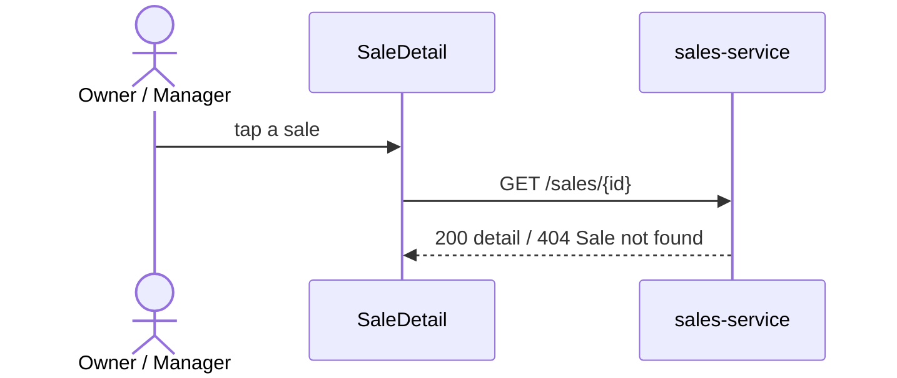
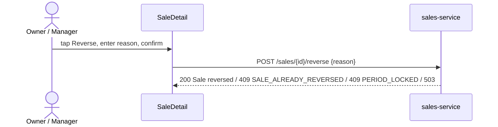

# Spec: Mobile sales management

**Prefix:** `MSL` · **Status:** ✅ Approved · **Version:** v2.1.0 · **Author:** Vuththana
**Tables:** `sales`, `sale_items` (sales-service; not yet in the data dictionary — see §8), read: `items`, `item_stocks`, `businesses.exchange_rate`
**Endpoints:** [api/identity-service.md § GET /api/v1/businesses/me/exchange-rate](../../api/identity-service.md#get-apiv1businessesmeexchange-rate) (new) · the rest exist in code and are listed in §9
**Routes (Android destinations):** `SalesList` (owner, manager; opened from Menu → Sales, MSL-D27) · `RecordSale` (owner, manager) · `SaleDetail(saleId)` (owner, manager)

<!--
HOW TO WRITE THIS FILE (delete nothing below; replace the <placeholders>)
- Status is one of: 📝 Draft · ✅ Approved · ⟳ Amending. Only /sdd:clarify sets ✅; only /sdd:amend sets ⟳.
- An ID is DEFINED where it starts a list item or table row in bold: `- **XXX-R01** …` or `| **XXX-D01** | …`.
  Anywhere else, write it plain (XXX-R01) — that's a reference. sddtool.py relies on this.
- IDs are never renumbered or reused. Withdraw by striking through: `- ~~**XXX-R07**~~ withdrawn in v5.3.0 — <why>`.
- One requirement = one testable sentence: who, when, what happens, which message. Long rules get several IDs.
- Values (limits, lengths, enums) come from the data dictionary. Quote the field, don't restate its type.
- Section numbers (§1 … §10, and §4a, §4b …) are stable once approved: other docs link to them.
-->

## 1. Summary and scope

Owners and branch managers of SME retail stores are often on the shop floor, away from a computer. This feature gives the
Android app the walk-in sales the web already has under Items: record a walk-in sale at the counter, see today's walk-in
figures, browse and filter past sales, open a sale, and reverse a wrong one. It calls the existing sales-service API
through the API Gateway. The one backend change is a read-only exchange-rate endpoint in identity-service that managers
can call (MSL-D15).

- **In:** the Sales screen, opened from the app menu (MSL-D27); the day KPI card; sales list with search and filters; record a walk-in sale
  (items by name/SKU search, USD or KHR, editable prices, discount, tax, payment method, "paid into" account, sale date);
  sale detail; reverse a sale with a reason.
- **Out:**
  - Invoices, customers, invoice payments and the month sales overview (web "Sales management", prefix `SLM`) — a later spec.
  - Sales from Shopify, WeBill365 and file import are listed and viewable, but never recorded on mobile.
  - Offline recording / sync (MSL-D04), barcode scanning and quick-add grids (MSL-D05), a manual receipt or order number
    (MSL-D09), printing or sharing a receipt, Khmer text (MSL-D08), an idempotency key on `POST /sales` (MSL-D16), a
    server-side future-date rule (MSL-D14).
  - Creating or editing items, stock, branches or money accounts: the sale form only reads them.
  - The app shell (bottom bar, Dashboard, Menu) belongs to the team's shell, not this spec; refreshing the Dashboard
    after a sale is recorded or reversed is out of scope (MSL-D30).
- **Depends on:** Android sign-in and session (the existing `auth` feature: the signed-in user's role and `branch_id`),
  and the team's app shell (Dashboard start screen, bottom bar, Menu) that this feature plugs into (MSL-D27).
  The web walk-in flow (`ITM` in web-ui) is the reference behaviour; its spec text is not in these docs.

## 2. Roles and branch scope

| Role | Can | Scope |
|---|---|---|
| `BUSINESS_OWNER` | See the KPI card and sales, record and reverse sales | All branches; picks the branch for a new sale and can filter the list by branch |
| `BRANCH_MANAGER` | See the KPI card and sales, record and reverse sales | Locked to `users.branch_id`; no branch picker or branch filter |

- Scope is enforced by sales-service, never trusted from the app: a manager asking for another branch's sale gets
  `404 Sale not found`, a write to another branch `403 BRANCH_ACCESS_DENIED` (MSL-E03, MSL-E04).
- A sale always belongs to one branch (`sales.branch_id`); there are no business-wide sales. Money accounts can be
  business-wide (MSL-D22).
- A deactivated user is signed out by the existing session handling; nothing sales-specific.

## 3. Decisions

| ID | Topic | Decision |
|---|---|---|
| **MSL-D01** | Scope | Walk-in sales (record, list, view, reverse) plus the day KPI card. Invoices, customers, payments and overview are a later spec. (User, 2026-11-12) |
| **MSL-D02** | Roles | Both `BUSINESS_OWNER` and `BRANCH_MANAGER`, with branch scope as on web. (User, 2026-11-12) |
| **MSL-D03** | Reversal | Owner and manager may reverse any sale they can see, with a required reason, as on web. (User, 2026-11-12) |
| **MSL-D04** | Connectivity | Online only. No local queue. A failed send shows an error with Retry; a guard stops one tap sending a sale twice. (User, 2026-11-12) |
| **MSL-D05** | Adding items | Search active items by name or SKU, showing stock at the sale's branch. No barcode scan, no quick-add grid. (User, 2026-11-12) |
| **MSL-D06** | Currency and prices | As web: the user picks USD or KHR; unit prices prefill from `items.selling_price` (converted for KHR) and can be edited; discount and tax are entered; the total also shows "≈" in the other currency. (User, 2026-11-12) |
| **MSL-D07** | Sale date | Defaults to now; the user may pick an earlier date and time in Asia/Phnom_Penh; not a future one. (User, 2026-11-12) |
| **MSL-D08** | Language | English only for now; every string is in Android resources so Khmer can be added later. (User, 2026-11-12) |
| **MSL-D09** | Receipt number | No manual receipt or order number; the server-generated `sales.sale_reference` (WS-{yyyy}-{seq}) is shown after saving. (User, 2026-11-12) |
| **MSL-D10** | Paid-into account | As web: only accounts usable by the sale branch in the sale currency are offered, one preselected (MSL-D22); none → MSL-M05 and the sale can't be saved. (User, 2026-11-12) |
| **MSL-D11** | List filters | Search, date range, payment method, status, branch (owner only), plus the day KPI card. (User, 2026-11-12) |
| **MSL-D12** | Source | Sales recorded on mobile are sent with `source` = `WALK_IN`, so they count on the KPI card. (User, 2026-11-12, MSL-Q12) |
| **MSL-D13** | Owner's default branch | An owner's list and KPI card start on "All branches"; a new sale starts with no branch picked, except that the only active branch is preselected. Nothing is remembered between sessions. (User, 2026-11-12, MSL-Q06) |
| **MSL-D14** | Future dates | Blocked in the app only; sales-service is not changed. (User, 2026-11-12, MSL-Q01) |
| **MSL-D15** | Exchange rate for managers | identity-service adds a read-only `GET /api/v1/businesses/me/exchange-rate` for owner and manager; the app uses it for KHR prefill and every "≈" amount. (User, 2026-11-12, MSL-Q02) |
| **MSL-D16** | Lost answer on save | No idempotency key. After a lost answer the app warns that the sale may already be recorded and offers "Check sales" before any retry, or "Discard" (MSL-D28). (User, 2026-11-12, MSL-Q03) |
| ~~**MSL-D17**~~ withdrawn in v2.0.0 — replaced by MSL-D27. Was: | Navigation | A bottom navigation bar with Sales and Profile; later features add tabs. (User, 2026-11-12, MSL-Q04) |
| **MSL-D18** | KPI card | The card shows the server's figures as returned: USD, completed walk-in sales only, labelled "Walk-in sales today". The list is not limited to match it. (User, 2026-11-12, MSL-Q05, MSL-Q08) |
| **MSL-D19** | Timestamps | Timestamps the API returns without an offset (`sale_date`, `reversed_at`) are UTC; the app converts them to Asia/Phnom_Penh for display. (User, 2026-11-12, MSL-Q07) |
| ~~**MSL-D20**~~ withdrawn in v1.0.0 — replaced by MSL-D24. Was: | Item details on the form | When an item is added, the app reads `GET /items/{id}` (for `allows_decimals`, `selling_price`, `cost_price`) and the item's stock at the sale branch from `GET /items/stocks?branchId`. No backend change. (User, 2026-11-12, MSL-Q09) |
| **MSL-D21** | Period locked on save | A `409 PERIOD_LOCKED` on `POST /sales` shows the server message at the sale date so the user can change it; back-dating is not otherwise limited. (User, 2026-11-12, MSL-Q10) |
| **MSL-D22** | Accounts offered | Active branch accounts and active business-wide accounts in the sale currency; the first branch account is preselected, else the first business-wide one. (User, 2026-11-12, MSL-Q11) |
| **MSL-D23** | Price below cost | Allowed, with a warning on the line (MSL-M18), as web. (User, 2026-11-12, MSL-Q13) |
| **MSL-D24** | Item details on the form | When an item is added, the app reads `GET /items/{id}` once: `item` gives `allows_decimals`, `selling_price`, `cost_price`; `stock_by_branch` gives the stock at the sale branch: its entry in `stock_by_branch` (the server lists every branch the user may read; a missing entry is treated as 0). Works for items without a SKU. No backend change. (User, 2026-11-12, amendment) |
| **MSL-D25** | Failures not covered by MSL-M19 | A `POST /sales` that fails before anything was sent (no network, DNS failure, connection refused) and a `POST /sales/{id}/reverse` that gets no answer both show MSL-M08 with Retry, keeping what was entered. "Not sent" = no network, DNS failure, connection refused or connect timeout; any failure after the connection was made (read timeout, connection reset) on `POST /sales` is MSL-R40. A retried reverse that had gone through answers `409 SALE_ALREADY_REVERSED` (MSL-R35). (User, 2026-11-12, amendment) |
| **MSL-D26** | Line inputs | Quantity, price, discount and tax fields accept no minus sign; KHR prices, discount and tax are typed in whole riel, USD ones with at most 2 decimals. Missing line texts come from web and the server (MSL-M21 … MSL-M23). (User, 2026-11-12, amendment) |
| **MSL-D27** | Navigation | The feature follows the team's app shell: after sign-in the app opens the Dashboard; the Sales screen is opened from Menu → Sales as a pushed screen with a back arrow, not as a bottom-bar tab. The pushed Sales screens (list, form, detail) show no bottom bar, as the shell does for every pushed screen (MSL-Q17). Back from a Sales screen reached any other way goes to the Dashboard (MSL-Q16). Profile and settings are reached from the Menu, not from Sales. (User, 2026-11-15, amendment) |
| **MSL-D28** | Leaving after a lost answer | MSL-M19 also offers "Discard", which closes the dialog and the form without sending anything, so a user who found the sale already recorded can leave without recording it twice. Because the sale may not have been recorded, "Discard" asks for confirmation first (MSL-M24, MSL-Q19); after it the user is on the refreshed sales list (MSL-Q15). MSL-M19's text tells the user to choose "Discard" when they find the sale recorded (MSL-Q20). (User, 2026-11-15, amendment) |
| **MSL-D29** | MSL-M19 is modal | Back and a tap outside don't close MSL-M19; only "Check sales", "Try again" and "Discard" leave it. It survives rotation, backgrounding and process death with the form, so the duplicate-sale guard of MSL-D16 can't be bypassed. Every lost answer, including one on "Try again", shows it again (MSL-Q14, MSL-Q21, MSL-Q22). (User, 2026-11-15, amendment) |
| **MSL-D30** | Dashboard | The Dashboard is not part of this feature: recording or reversing a sale doesn't refresh it here; it keeps its own refresh rules (MSL-Q18). (User, 2026-11-15, amendment) |
| **MSL-D31** | Killed while saving | A `POST /sales` still waiting for its answer when the app is killed counts as a lost answer: on return the form is shown with MSL-M19, never with an enabled save and no warning (MSL-Q23). (User, 2026-11-15, amendment) |
| **MSL-D32** | Leaving MSL-M24 | Back and a tap outside MSL-M24 act as "Cancel": MSL-M24 closes and MSL-M19 shows again; nothing is discarded (MSL-Q24). (User, 2026-11-15, amendment) |

## 4. Journeys

> Diagrams are Mermaid. All server steps go through the API Gateway (`/api/v1/...`) with the user's token.

### 4a. See today's sales and the list


Realises MSL-R01 … MSL-R08, MSL-R50.

### 4b. Record a walk-in sale

```mermaid
sequenceDiagram
    actor U as Owner / Manager
    participant UI as RecordSale
    participant S as sales-service
    participant F as finance-service
    participant I as identity-service
    UI->>I: GET /branches (owner only) · GET /businesses/me/exchange-rate
    U->>UI: choose branch, currency, search items
    UI->>S: GET /items?search=…&status=ACTIVE&branchId
    U->>UI: pick an item
    UI->>S: GET /items/{id} (item + stock_by_branch)
    UI->>F: GET /bank-statements/accounts?branchId&status=ACTIVE
    U->>UI: quantities, prices, discount, tax, payment method, account, date
    U->>UI: tap "Record sale · {total}"
    UI->>S: POST /sales
    S->>F: income transaction (sales-service calls finance; the app doesn't)
    S-->>UI: 201 Sale recorded / 422 INSUFFICIENT_STOCK / 422 INVALID_AMOUNT / 409 BRANCH_INACTIVE / 409 PERIOD_LOCKED / 503
    UI-->>U: SaleDetail of the new sale
```

Realises MSL-R09 … MSL-R27, MSL-R40, MSL-R42 … MSL-R45, MSL-R47 … MSL-R49, MSL-R51, MSL-R52.

### 4c. View a sale



Realises MSL-R28 … MSL-R30.

### 4d. Reverse a sale



Realises MSL-R31 … MSL-R35, MSL-R46.

## 5. Requirements

### Sales list and KPIs (§4a)

- **MSL-R01** · Owner, Manager · §4a — When the sales list opens, the app shows a card titled "Walk-in sales today" (Asia/Phnom_Penh day) from `GET /sales/summary`: total in USD, number of sales, average sale and KHQR share, each with its change against the same weekday last week, as returned by the server (MSL-D18).
- **MSL-R02** · Owner, Manager · §4a — The list shows sales newest first, one row each with `sales.sale_reference`, `sales.sale_date` (local time, MSL-R39), branch name (owner only), source label (`WALK_IN`, `POS`, `SHOPIFY`, `WEBILL365`, `FILE_IMPORT`), payment method, `sales.total_amount` in `sales.currency`, and status; a `REVERSED` sale is visibly marked.
- **MSL-R03** · Owner, Manager · §4a — The list loads pages of 20 (the server default `size`, so the app may omit it; default order `sale_date` newest first) and loads the next page when the user scrolls to the end.
- **MSL-R04** · Owner, Manager · §4a — Search matches a sale number or an item name (`search`), and refreshes the list after the user stops typing.
- **MSL-R05** · Owner, Manager · §4a — The user can filter by date range (`from`/`to`, local dates, inclusive), payment method (`sales.payment_method`) and status (`COMPLETED`, `REVERSED`); active filters are visible and can be cleared in one tap.
- **MSL-R06** · Owner · §4a — An owner can filter the list and the KPI card by one branch or "All branches" (the start value, MSL-D13); a manager sees no branch filter and only their branch.
- **MSL-R07** · Owner, Manager · §4a — Pull-to-refresh reloads the KPI card and the first page.
- **MSL-R08** · Owner, Manager · §4a — With no sales for the filters the list shows MSL-M01 and, when filters are active, a "Clear filters" action.

### Record a sale (§4b)

- **MSL-R09** · Owner, Manager · §4b — "Record sale" is reachable from the sales list.
- **MSL-R10** · Manager · §4b — A manager's sale branch is their own branch and can't be changed.
- **MSL-R11** · Owner · §4b — An owner must choose the sale branch from the business's active branches before adding items; changing it clears the lines and the account.
- **MSL-R12** · Owner, Manager · §4b — The user picks the currency, `USD` or `KHR` (`sales.currency`).
- ~~**MSL-R13**~~ withdrawn in v1.0.0 — replaced by MSL-R44 (stock from `stock_by_branch`). Was: · Owner, Manager · §4b — Item search calls `GET /items` with `search` and `status=ACTIVE`, matching name or SKU; when the user picks a result the app reads the item (`GET /items/{id}`) and its stock at the sale branch (`GET /items/stocks` with `branchId` and `search` set to the item's SKU, reading the row whose `item_id` matches; its `quantities` map has the branch's stock) and shows that stock on the line (MSL-D20).
- **MSL-R14** · Owner, Manager · §4b — Picking an item already on the sale adds 1 to that line's quantity instead of adding a second line.
- **MSL-R15** · Owner, Manager · §4b — A new line's unit price prefills from `items.selling_price` (USD), multiplied by `businesses.exchange_rate` from `GET /businesses/me/exchange-rate` and rounded to whole riel when the currency is KHR; the user may edit it.
- **MSL-R16** · Owner, Manager · §4b — Changing the currency re-prefills every line's unit price, resets discount and tax to 0 and re-suggests the account.
- **MSL-R17** · Owner, Manager · §4b — Quantity must be more than 0 with at most 3 decimals (empty, 0 or too many decimals: MSL-R47); for an item whose `allows_decimals` is false it must be a whole number, else MSL-M03 on the line.
- **MSL-R18** · Owner, Manager · §4b — A quantity above the item's stock at the sale branch shows MSL-M02 on the line and blocks saving.
- **MSL-R19** · Owner, Manager · §4b — The form shows subtotal, discount, tax and total (total = subtotal − discount + tax), updated as the user edits, and the total "≈" in the other currency, which the app computes with the exchange rate (the API returns no such field).
- **MSL-R20** · Owner, Manager · §4b — Discount and tax must be 0 or more and the discount can't exceed the subtotal, else MSL-M04.
- **MSL-R21** · Owner, Manager · §4b — The user picks a payment method from `CASH`, `KHQR`, `ABA`, `WING`, `CARD`, `OTHER` (`sales.payment_method`); none is preselected.
- **MSL-R22** · Owner, Manager · §4b — "Paid into" lists the active accounts from `GET /bank-statements/accounts?branchId&status=ACTIVE` whose currency is the sale currency (branch and business-wide), and preselects the first branch account, else the first business-wide one (MSL-D22); when there is none it shows MSL-M05 and saving is blocked.
- **MSL-R23** · Owner, Manager · §4b — Sale date and time default to now and can be changed to any earlier moment in Asia/Phnom_Penh; a future moment can't be picked (MSL-D14); it is sent as ISO-8601 with the `+07:00` offset (the server stores UTC).
- **MSL-R24** · Owner, Manager · §4b — The save button reads "Record sale · {total}" and is enabled only when branch, at least one line, payment method and account are set and no field shows an error.
- **MSL-R25** · Owner, Manager · §4b — Tapping save sends one `POST /sales` with `source` `WALK_IN` (MSL-D12); the button shows progress and ignores further taps until the answer.
- **MSL-R26** · Owner, Manager · §4b — On `201` the app shows MSL-M06 and opens the new sale's detail; going back returns to the refreshed list (the one opened from Menu → Sales, MSL-R50), not the form.
- **MSL-R27** · Owner, Manager · §4b — On an error answer the form keeps everything entered and shows the message for the code (MSL-M02, M03, M04, M07, M09, M10, M11, M17, M20); `409 PERIOD_LOCKED` shows at the sale date (MSL-D21); a `503` offers Retry.

### View a sale (§4c)

- **MSL-R28** · Owner, Manager · §4c — The detail shows reference, date, branch, source, status, who recorded it, each line (item, quantity, unit price, line total), subtotal, discount, tax, shipping (when not 0), total with its "≈" other-currency amount computed by the app, payment method and the paid-into account.
- **MSL-R29** · Owner, Manager · §4c — A reversed sale also shows when and by whom it was reversed and the reason.
- **MSL-R30** · Owner, Manager · §4c — A sale the user can't see or that doesn't exist shows MSL-M12 with a "Back to sales" action.

### Reverse a sale (§4d)

- **MSL-R31** · Owner, Manager · §4d — A `COMPLETED` sale's detail offers "Reverse sale"; a `REVERSED` sale doesn't.
- **MSL-R32** · Owner, Manager · §4d — "Reverse sale" opens a confirmation (MSL-M13) with a required reason; confirming with an empty reason shows MSL-M14 without calling the server.
- **MSL-R33** · Owner, Manager · §4d — Confirming sends `POST /sales/{id}/reverse` once with the reason; the confirm button ignores further taps until the answer.
- **MSL-R34** · Owner, Manager · §4d — On success the app shows MSL-M15 and the detail shows the sale as reversed; the list and KPI card are refreshed when the user returns.
- **MSL-R35** · Owner, Manager · §4d — On `409 SALE_ALREADY_REVERSED` the app shows MSL-M16 and reloads the detail; on `409 PERIOD_LOCKED` it shows MSL-M17; on `503` or another refusal it shows MSL-M09 / MSL-M11 with Retry and the sale stays `COMPLETED`.

### Common

- **MSL-R36** · Owner, Manager · all — Every screen shows a loading state, and a failed load shows MSL-M08 (connection) or the server message with a Retry action.
- **MSL-R37** · Owner, Manager · all — Money is shown with the currency: USD with 2 decimals and "$", KHR with no decimals and "៛".
- **MSL-R38** · Owner, Manager · all — Every user-visible string is an Android string resource (MSL-D08).
- **MSL-R39** · Owner, Manager · all — Timestamps from the API without an offset are read as UTC and shown in Asia/Phnom_Penh (MSL-D19).
- **MSL-R40** · Owner, Manager · §4b — When `POST /sales` gets no answer (connection lost or timeout after sending), the form stays and shows MSL-M19 with "Check sales" (opens the list in a new screen, the form kept), "Try again" and "Discard" (MSL-R51) (MSL-D16, MSL-D28).
- ~~**MSL-R41**~~ withdrawn in v2.0.0 — replaced by MSL-R50 (the app follows the team's shell). Was: · Owner, Manager · §4a — After sign-in the app shows a bottom navigation bar with Sales and Profile; Sales is the start tab (MSL-D17).
- **MSL-R42** · Owner · §4b — When the business has exactly one active branch, an owner's new sale preselects it (MSL-D13).
- **MSL-R43** · Owner, Manager · §4b — A unit price below the item's `cost_price` (for KHR, the cost converted with the business exchange rate, not rounded) shows MSL-M18 as a warning on the line; saving stays allowed (MSL-D23).
- **MSL-R44** · Owner, Manager · §4b — Item search calls `GET /items` with `search`, `status=ACTIVE` and `branchId` = the sale branch, matching name or SKU; when the user picks a result the app reads `GET /items/{id}` and shows on the line the stock from the sale branch's entry in `stock_by_branch` (the server lists every branch the user may read; a missing entry is treated as 0) (MSL-D24).
- **MSL-R45** · Owner, Manager · §4b — When `POST /sales` fails before the request was sent (no network, DNS failure, connection refused or connect timeout; MSL-D25), the form keeps everything entered and shows MSL-M08 with Retry (MSL-D25).
- **MSL-R46** · Owner, Manager · §4d — When `POST /sales/{id}/reverse` fails on the connection (before sending or with no answer), the dialog keeps the reason and shows MSL-M08 with Retry; the sale stays as last loaded (MSL-D25).
- **MSL-R47** · Owner, Manager · §4b — A quantity that is empty or 0 shows MSL-M21 on the line, and one with more than 3 decimals shows MSL-M23; both block saving.
- **MSL-R48** · Owner, Manager · §4b — A unit price the user empties shows MSL-M22 on the line and blocks saving.
- **MSL-R49** · Owner, Manager · §4b — Quantity, unit price, discount and tax fields don't accept a minus sign; in a KHR sale prices, discount and tax accept whole riel only, in a USD sale at most 2 decimals (MSL-D26).
- **MSL-R50** · Owner, Manager · §4a — The sales list opens from Menu → Sales as a screen with a back arrow that returns to the screen it was opened from (the Dashboard when Sales was reached another way); the Sales screens show no bottom bar; the app's start screen after sign-in is the Dashboard, not Sales (MSL-D27).
- **MSL-R51** · Owner, Manager · §4b — MSL-M19 also offers "Discard": it first asks MSL-M24; confirming closes the dialog and the form without sending anything and returns to the sales list, refreshed; "Cancel" goes back to MSL-M19. A sale the server had recorded stays on record (MSL-D28).
- **MSL-R52** · Owner, Manager · §4b — Back and a tap outside don't close MSL-M19, and MSL-M19 is shown again with the form after rotation, backgrounding or process death (MSL-D29).

### Fields

Sent in `POST /sales` (code: `SaleRequest`, `SaleLineRequest` in sales-service); cited from code until the dictionary has them (§8).

| Field | Rule | Requirement |
|---|---|---|
| `sales.branch_id` | required; an active branch the user may write to | MSL-R10, MSL-R11 |
| `sales.sale_date` | optional, default now; ISO-8601 with offset | MSL-R23 |
| `sales.source` | `WALK_IN` from mobile | MSL-R25 |
| `sales.currency` | required; `USD` or `KHR` | MSL-R12 |
| `sale_items.item_id` | required; an active item | MSL-R44 |
| `sale_items.quantity_sold` | required; > 0; at most 9 digits and 3 decimals | MSL-R17 |
| `sale_items.unit_price` | optional, ≥ 0, at most 13 digits and 2 decimals; default the selling price | MSL-R15 |
| `sales.discount_amount` | ≥ 0, at most 13 digits and 2 decimals; ≤ subtotal | MSL-R20 |
| `sales.tax_amount` | ≥ 0, at most 13 digits and 2 decimals | MSL-R20 |
| `sales.payment_method` | required; enum above | MSL-R21 |
| `sales.financial_account_id` | required; a finance-service account | MSL-R22 |
| `sales.reverse_reason` | required to reverse | MSL-R32 |
| `businesses.exchange_rate` | read only; KHR per 1 USD | MSL-R15, MSL-R19 |

## 6. Messages

| ID | HTTP · code | Text (English; Khmer later) | Used by |
|---|---|---|---|
| **MSL-M01** | — | "No sales yet." (no filters) / "No sales match these filters." | MSL-R08 |
| **MSL-M02** | `422 · INSUFFICIENT_STOCK` | Client: "Not enough stock for {item_name}."; server: its message (e.g. "Not enough stock of '{item_name}' (available {n})") | MSL-R18, MSL-R27 |
| **MSL-M03** | `422 · DECIMALS_NOT_ALLOWED` | Client: "Quantity must be a whole number"; server: its message ("'{item_name}' is counted in whole numbers only") | MSL-R17, MSL-R27 |
| **MSL-M04** | `422 · INVALID_AMOUNT` | Client: "The discount is larger than the subtotal" / "Discount and tax must be 0 or more"; server: its message (e.g. "The sale total is too large to record") | MSL-R20, MSL-R27 |
| **MSL-M05** | — | "This branch has no account in this currency" | MSL-R22 |
| **MSL-M06** | `201` | "Sale recorded" | MSL-R26 |
| **MSL-M07** | `409 · BRANCH_INACTIVE` | "This branch is inactive. Choose an active branch" | MSL-R27 |
| **MSL-M08** | connection error | "Can't reach the server. Check your connection and try again." | MSL-R36, MSL-R45, MSL-R46 |
| **MSL-M09** | `503 · DEPENDENCY_UNAVAILABLE` | The server message (e.g. "Finance service is unavailable, please try again") | MSL-R27, MSL-R35 |
| **MSL-M10** | `422 · ITEM_INACTIVE` | The server message ("'{item_name}' is inactive and can't be sold") | MSL-R27 |
| **MSL-M11** | `422 · FINANCE_REJECTED` · `403 · BRANCH_ACCESS_DENIED` | The server message (e.g. "You don't have access to this branch") | MSL-R27, MSL-R35 |
| **MSL-M12** | `404 · NOT_FOUND` | "Sale not found" | MSL-R30 |
| **MSL-M13** | — | Title "Reverse sale?" · body "The sale stays on record as Reversed and can't be reversed again." | MSL-R32 |
| **MSL-M14** | `400 · VALIDATION_FAILED` | Client: "Enter a reason." (checked before sending; the server's "reason is required" is not expected) | MSL-R32 |
| **MSL-M15** | `200` | "Sale reversed" | MSL-R34 |
| **MSL-M16** | `409 · SALE_ALREADY_REVERSED` | "This sale was already reversed" | MSL-R35 |
| **MSL-M17** | `409 · PERIOD_LOCKED` | The server message | MSL-R27, MSL-R35 |
| **MSL-M18** | — | "Selling price is below cost" (warning) | MSL-R43 |
| **MSL-M19** | connection lost after sending | "We couldn't confirm the sale. It may already be recorded — check your sales before trying again. If you find it recorded, choose Discard." · buttons "Check sales", "Try again", "Discard" | MSL-R40, MSL-R51, MSL-R52 |
| **MSL-M20** | `422 · INVALID_QUANTITY` | The server message (e.g. "Quantities have at most 3 decimals"); not expected, the client checks first | MSL-R27 |
| **MSL-M21** | — | "Enter a quantity above 0." | MSL-R47 |
| **MSL-M22** | — | "Enter a price of 0 or more." | MSL-R48 |
| **MSL-M23** | — | Client: "Quantities have at most 3 decimals" (same text as the server's MSL-M20) | MSL-R47 |
| **MSL-M24** | — | Title "Discard this sale?" · body "It may not have been recorded." · buttons "Cancel", "Discard" | MSL-R51 |

## 7. Edge cases

- **MSL-E01** · Actions — The user taps "Record sale" twice quickly → one `POST /sales` only (MSL-R25).
- **MSL-E02** · Connectivity — The connection drops after `POST /sales` was sent and no answer arrives → MSL-M19 with "Check sales", "Try again" and "Discard" (MSL-R40); a retry after the sale was recorded creates a second sale, which the user can reverse (accepted, MSL-D16); "Discard" avoids this (MSL-R51).
- **MSL-E03** · Permissions — A manager opens another branch's sale (e.g. from a stale deep link) → MSL-M12 with "Back to sales".
- **MSL-E04** · Permissions — A manager's request carries another branch's `branch_id` → `403 BRANCH_ACCESS_DENIED`, MSL-M11; the app never sends one (MSL-R10).
- **MSL-E05** · Concurrency — Stock is sold elsewhere between picking and save → `422 INSUFFICIENT_STOCK`, MSL-M02; the form stays and the line's stock is re-read.
- **MSL-E06** · Concurrency — Two users reverse the same sale → the second gets MSL-M16 and sees the sale as reversed.
- **MSL-E07** · State — The owner's chosen branch was deactivated before saving → MSL-M07; the branch picker reloads.
- **MSL-E08** · State — An item on the form was deactivated before saving → MSL-M10 naming the item; the user removes the line.
- **MSL-E09** · State — The sale branch has no active account in the chosen currency (branch or business-wide) → MSL-M05; switching currency may offer one.
- ~~**MSL-E10**~~ withdrawn in v1.0.0 — replaced by MSL-E28 (a minus can't be typed). Was: · Validation — Quantity 0, negative or with more than 3 decimals → error on the line; save disabled (MSL-R17).
- **MSL-E11** · Validation — Discount larger than subtotal → MSL-M04; save disabled (MSL-R20).
- **MSL-E12** · Validation — The user edits a unit price below the item's cost → MSL-M18 warning on the line; the sale can be saved (MSL-R43).
- **MSL-E13** · Time — A sale recorded at 23:30 local time appears under that local day in the list and KPI card, not the UTC day (MSL-R39).
- **MSL-E14** · Time — The user picks a date, leaves the form open past midnight, then saves → the picked moment is sent, still not in the future.
- **MSL-E15** · Session — The token expires while the form is open → the existing refresh runs; if refresh fails the user is sent to sign in and the unsaved form is lost; after signing in the app opens the Dashboard (MSL-R50).
- **MSL-E16** · Empty — The business has no active items → item search shows "No items found"; no sale can be saved.
- **MSL-E17** · Data — A sale from Shopify, WeBill365 or file import is listed and opens in detail with its source label; it can be reversed under the same rules (MSL-D03). It is not counted on the KPI card (MSL-D18).
- **MSL-E18** · Money — A KHR sale shows whole riel, and the "≈ USD" line uses the business exchange rate; the stored totals are the server's, never the app's.
- **MSL-E19** · Device — The app is backgrounded or rotated mid-form → the entered values survive.
- **MSL-E20** · State — An item has 0 stock at the sale branch → it is shown as "Out of stock" in the search results and, if picked, its line shows MSL-M02 and saving is blocked (MSL-R18). The search row's `total_stock` and `stock_status` are for the sale branch because the list is called with `branchId` (MSL-R44).
- **MSL-E21** · Connectivity — Loading the next list page fails while earlier rows are shown → the rows stay and the end of the list shows MSL-M08 with Retry.
- **MSL-E22** · Permissions — A manager's own branch is deactivated → `POST /sales` returns `409 BRANCH_INACTIVE`, MSL-M07; there is no branch to switch to, so the form offers only Back.
- **MSL-E23** · Money — The exchange rate changes between prefill and save → prices are sent as shown; the server computes the stored totals and its USD value with the rate at save time.
- **MSL-E24** · Actions — Reversing fails because finance-service is unavailable (`503`) or refuses → MSL-M09 / MSL-M11 with Retry; the sale stays `COMPLETED` (MSL-R35).
- **MSL-E25** · Text — Long item names or references → list rows truncate to 2 lines; the detail shows the full text.
- **MSL-E26** · Connectivity — The exchange rate can't be loaded → a KHR sale can't be prefilled; the form shows MSL-M08 with Retry and only USD can be chosen until the rate loads.
- **MSL-E27** · Connectivity — The exchange rate can't be loaded when SaleDetail opens (MSL-R28) → the detail shows without the "≈" line, and the rate load can be retried.
- **MSL-E28** · Validation — Quantity empty or 0 → MSL-M21; more than 3 decimals → MSL-M23; a minus sign can't be typed; save disabled (MSL-R47, MSL-R49).
- **MSL-E29** · Connectivity — No network when the user taps "Record sale" → the request is never sent; MSL-M08 with Retry, no "may already be recorded" warning (MSL-R45).
- **MSL-E30** · Connectivity — The connection drops after a reverse was sent → MSL-M08 with Retry; if the reverse had gone through, the retry answers `409` and the app shows MSL-M16 and the reversed sale (MSL-R46, MSL-R35).
- **MSL-E31** · Data — An item has no SKU → it is found by name, and its branch stock still comes from `stock_by_branch` (MSL-R44).
- **MSL-E32** · Connectivity — After MSL-M19 the user taps "Check sales", finds the sale recorded, comes back (MSL-M19 is shown again) and taps "Discard" and confirms MSL-M24 → the form closes with no second `POST /sales`; the recorded sale stays in the list (MSL-R51).
- **MSL-E33** · Device — The device is rotated, or the app backgrounded or killed, while MSL-M19 is shown → on return MSL-M19 is shown again with the form kept (MSL-R52).
- **MSL-E34** · Connectivity — The user taps "Try again" after MSL-M19 and that answer is lost too → MSL-M19 is shown again, with all three actions (MSL-R40).
- **MSL-E35** · Actions — The user taps "Discard" in MSL-M24 twice quickly → the form closes once and no request is sent (MSL-R51).
- **MSL-E36** · Device — The app is killed while the first `POST /sales` is still waiting for its answer → on return the form is shown with MSL-M19 (MSL-R40, MSL-R52, MSL-D31).
- **MSL-E37** · Actions — The user presses Back or taps outside while MSL-M24 is open → MSL-M24 closes and MSL-M19 shows again; the form is kept (MSL-R51, MSL-D32).

## 8. Data dictionary changes

| Table.field | Change | Why | State |
|---|---|---|---|
| `sales` (all columns) | Add the table to `data-dictionary/` as it is in sales-service V1, V3, V4 migrations | Fields cited in §5 | proposed |
| `sale_items` (all columns) | Add the table as in sales-service V1 | Fields cited in §5 | proposed |
| `items`, `item_stocks` | Add the tables (read by the sale form; `allows_decimals`, `selling_price`, `cost_price`) | MSL-R44, MSL-R15, MSL-R17, MSL-R18, MSL-R43 | proposed |
| `businesses.exchange_rate` | Add (identity-service): integer 1–100000, KHR per 1 USD, default 4100; read only here | MSL-R15, MSL-R19 | proposed |

No new or changed columns: the scope needs none. The tables are copied from the existing migrations when the team writes the dictionary.

## 9. Endpoints

| Method · path | Service | Who | Requirements | In api/? |
|---|---|---|---|---|
| `GET /api/v1/sales/summary` | sales-service | Owner, Manager | MSL-R01, MSL-R06 | 📝 exists in code, not yet listed |
| `GET /api/v1/sales` | sales-service | Owner, Manager | MSL-R02 … MSL-R08 | 📝 exists in code, not yet listed |
| `POST /api/v1/sales` | sales-service | Owner, Manager | MSL-R25 … MSL-R27, MSL-R40 | 📝 exists in code, not yet listed |
| `GET /api/v1/sales/{id}` | sales-service | Owner, Manager | MSL-R28 … MSL-R30 | 📝 exists in code, not yet listed |
| `POST /api/v1/sales/{id}/reverse` | sales-service | Owner, Manager | MSL-R31 … MSL-R35 | 📝 exists in code, not yet listed |
| `GET /api/v1/items` | sales-service | Owner, Manager | MSL-R44 | 📝 exists in code, not yet listed |
| `GET /api/v1/items/{id}` | sales-service | Owner, Manager | MSL-R44, MSL-R15, MSL-R17, MSL-R18, MSL-R43 | 📝 exists in code, not yet listed |
| ~~`GET /api/v1/items/stocks`~~ | sales-service | — | no longer used (MSL-D24) | — |
| `GET /api/v1/bank-statements/accounts` | finance-service | Owner, Manager | MSL-R22 | 📝 exists in code, not yet listed |
| `GET /api/v1/branches` | identity-service (`status` defaults to active) | Owner | MSL-R06, MSL-R11, MSL-R42 | 📝 exists in code, not yet listed |
| `GET /api/v1/businesses/me/exchange-rate` | identity-service — **new** | Owner, Manager | MSL-R15, MSL-R19, MSL-R43 | 📝 planned |

The income transaction for a sale is written by sales-service calling finance-service (`FeignFinanceGateway.recordSaleIncome`); the app never writes to finance-service.

## 10. Questions

- **MSL-Q01** · §4b — Should sales-service also reject future sale dates? → MSL-D14 (answered 2026-11-12 by Vuththana)
- **MSL-Q02** · §4b — The rate endpoint (`GET /businesses/me`) is owner-only; how does a manager get the rate? → MSL-D15 (answered 2026-11-12 by Vuththana)
- **MSL-Q03** · §7 — A retry after a lost answer can record a sale twice. → MSL-D16 (answered 2026-11-12 by Vuththana)
- **MSL-Q04** · §4a — Where does Sales sit in the app? → MSL-D17 (answered 2026-11-12 by Vuththana; now MSL-D27)
- **MSL-Q05** · §5 — In which currency is the KPI card? → MSL-D18 (answered 2026-11-12 by Vuththana)
- **MSL-Q06** · §2 — Owner's default branch. → MSL-D13 (answered 2026-11-12 by Vuththana)
- **MSL-Q07** · §5 — Timestamps without an offset: UTC by rule, or change the API? → MSL-D19 (answered 2026-11-12 by Vuththana)
- **MSL-Q08** · §4a — The KPI card counts completed walk-in sales only; the list shows all. → MSL-D18 (answered 2026-11-12 by Vuththana)
- **MSL-Q09** · §4b — Where the form gets `allows_decimals` and branch stock. → MSL-D24 (answered 2026-11-12 by Vuththana)
- **MSL-Q10** · §4b — `409 PERIOD_LOCKED` on a back-dated sale. → MSL-D21 (answered 2026-11-12 by Vuththana)
- **MSL-Q11** · §4b — Business-wide accounts in "Paid into", and which is suggested. → MSL-D22 (answered 2026-11-12 by Vuththana)
- **MSL-Q12** · §3 — Source of mobile sales. → MSL-D12 (answered 2026-11-12 by Vuththana)
- **MSL-Q13** · §7 — A unit price below cost. → MSL-D23 (answered 2026-11-12 by Vuththana)
- **MSL-Q14** · §4b — With "Discard" added to MSL-M19 (MSL-R51), may Back or a tap outside the dialog also close it? → MSL-D29 (answered 2026-11-15 by Vuththana)
- **MSL-Q15** · §4b — Which screen does "Discard" return to? → MSL-D28 (answered 2026-11-15 by Vuththana)
- **MSL-Q16** · §4a — Where does Back go when Sales was reached other than from the Menu? → MSL-D27 (answered 2026-11-15 by Vuththana)
- **MSL-Q17** · §4a — Do the pushed Sales screens show the bottom bar? → MSL-D27 (settled 2026-11-15 from the team shell: pushed screens have none)
- **MSL-Q18** · §1 — Does a sale refresh the Dashboard? → MSL-D30 (answered 2026-11-15 by Vuththana)
- **MSL-Q19** · §4b — Does "Discard" need a confirmation? → MSL-D28, MSL-M24 (answered 2026-11-15 by Vuththana)
- **MSL-Q20** · §6 — Should MSL-M19's text mention "Discard"? → MSL-D28, MSL-M19 (answered 2026-11-15 by Vuththana)
- **MSL-Q21** · §7 — A lost answer on "Try again" → MSL-D29, MSL-E34 (answered 2026-11-15 by Vuththana)
- **MSL-Q22** · §7 — MSL-M19 after rotation or process death → MSL-D29 (answered 2026-11-15 by Vuththana)
- **MSL-Q23** · §7 — The app is killed while the first `POST /sales` is in flight: plain form or MSL-M19 on return? → MSL-D31 (answered 2026-11-15 by Vuththana)
- **MSL-Q24** · §7 — Back or a tap outside on MSL-M24? → MSL-D32 (answered 2026-11-15 by Vuththana)
