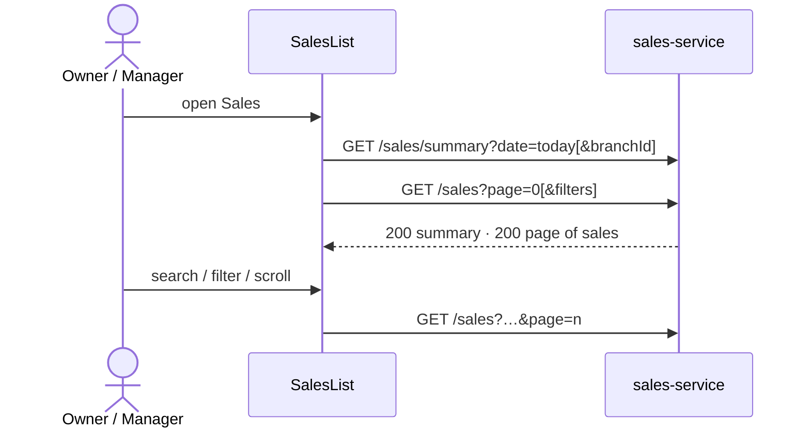
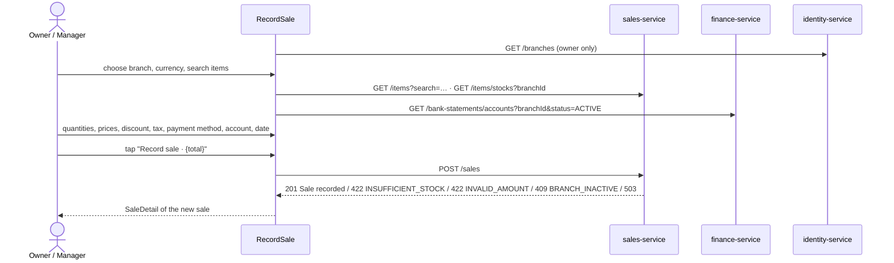
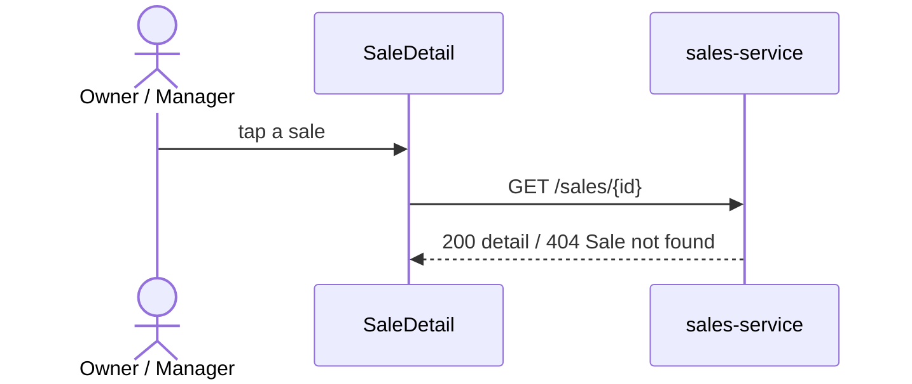
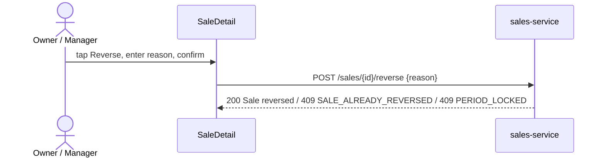

# Spec: Mobile sales management

**Prefix:** `MSL` · **Status:** 📝 Draft · **Version:** v0.2.0 · **Author:** Vuththana
**Tables:** `sales`, `sale_items` (sales-service; not yet in the data dictionary — see §8), read: `items`, `item_stocks`
**Endpoints:** none listed in `api/` yet · all in §9
**Routes (Android destinations):** `SalesList` (owner, manager) · `RecordSale` (owner, manager) · `SaleDetail(saleId)` (owner, manager)

<!--
HOW TO WRITE THIS FILE (delete nothing below; replace the <placeholders>)
- Status is one of: 📝 Draft · ✅ Approved · ⟳ Amending. Only /sdd:clarify sets ✅; only /sdd:amend sets ⟳.
- An ID is DEFINED where it starts a list item or table row in bold: `- **XXX-R01** …` or `| **XXX-D01** | …`.
  Anywhere else, write it plain (XXX-R01) — that's a reference. sddtool.py relies on this.
- IDs are never renumbered or reused. Withdraw by striking through: `- ~~**XXX-R07**~~ withdrawn in v5.3.0 — <why>`.
- One requirement = one testable sentence: who, when, what happens, which message. Long rules get several IDs.
- Values (limits, lengths, enums) come from the data dictionary. Quote the field, don't restate its type.
- Section numbers (§1 … §10, and §4a, §4b …) are stable once approved: other docs link to them.
-->

## 1. Summary and scope

Owners and branch managers of SME retail stores are often on the shop floor, away from a computer. This feature gives the
Android app the walk-in sales the web already has under Items: record a walk-in sale at the counter, see today's sales
figures, browse and filter past sales, open a sale, and reverse a wrong one. It calls the existing sales-service API
through the API Gateway; no backend change is required by the decided scope.

- **In:** day KPI card; sales list with search and filters; record a walk-in sale (items by name/SKU search, USD or KHR,
  editable prices, discount, tax, payment method, "paid into" account, sale date); sale detail; reverse a sale with a reason.
- **Out:**
  - Invoices, customers, invoice payments and the month sales overview (web "Sales management", prefix `SLM`) — a later spec.
  - Sales from Shopify, WeBill365 and file import are listed and viewable, but never recorded on mobile.
  - Offline recording / sync (MSL-D04), barcode scanning and quick-add grids (MSL-D05), a manual receipt or order number
    (MSL-D09), printing or sharing a receipt, Khmer text (MSL-D08).
  - Creating or editing items, stock, branches or money accounts: the sale form only reads them.
- **Depends on:** Android sign-in and session (the existing `auth` feature: the signed-in user's role and `branch_id`).
  The web walk-in flow (`ITM` in web-ui) is the reference behaviour; its spec text is not in these docs.

## 2. Roles and branch scope

| Role | Can | Scope |
|---|---|---|
| `BUSINESS_OWNER` | See the KPI card and sales, record and reverse sales | All branches; picks the branch for a new sale and can filter the list by branch |
| `BRANCH_MANAGER` | See the KPI card and sales, record and reverse sales | Locked to `users.branch_id`; no branch picker or branch filter |

- Scope is enforced by sales-service, never trusted from the app: a manager asking for another branch's sale gets
  `404 Sale not found`, a write to another branch `403 BRANCH_ACCESS_DENIED` (MSL-E03, MSL-E04).
- A sale always belongs to one branch (`sales.branch_id`); there are no business-wide sales.
- A deactivated user is signed out by the existing session handling; nothing sales-specific.

## 3. Decisions

| ID | Topic | Decision |
|---|---|---|
| **MSL-D01** | Scope | Walk-in sales (record, list, view, reverse) plus the day KPI card. Invoices, customers, payments and overview are a later spec. (User, 2026-11-12) |
| **MSL-D02** | Roles | Both `BUSINESS_OWNER` and `BRANCH_MANAGER`, with branch scope as on web. (User, 2026-11-12) |
| **MSL-D03** | Reversal | Owner and manager may reverse any sale they can see, with a required reason, as on web. (User, 2026-11-12) |
| **MSL-D04** | Connectivity | Online only. No local queue. A failed send shows an error with Retry; a guard stops one sale being sent twice. (User, 2026-11-12) |
| **MSL-D05** | Adding items | Search active items by name or SKU, showing stock at the sale's branch. No barcode scan, no quick-add grid. (User, 2026-11-12) |
| **MSL-D06** | Currency and prices | As web: the user picks USD or KHR; unit prices prefill from `items.selling_price` (converted for KHR) and can be edited; discount and tax are entered; the total also shows "≈" in the other currency. (User, 2026-11-12) |
| **MSL-D07** | Sale date | Defaults to now; the user may pick an earlier date and time in Asia/Phnom_Penh; not a future one. (User, 2026-11-12) |
| **MSL-D08** | Language | English only for now; every string is in Android resources so Khmer can be added later. (User, 2026-11-12) |
| **MSL-D09** | Receipt number | No manual receipt or order number; the server-generated `sales.sale_reference` (WS-{yyyy}-{seq}) is shown after saving. (User, 2026-11-12) |
| **MSL-D10** | Paid-into account | As web: only the sale branch's accounts in the sale currency are offered, one suggested; none → MSL-M05 and the sale can't be saved. (User, 2026-11-12) |
| **MSL-D11** | List filters | Search, date range, payment method, status, branch (owner only), plus the day KPI card. (User, 2026-11-12) |
| **MSL-D12** | Source | Sales recorded on mobile are sent with `source` = `WALK_IN`. Proposal. |
| **MSL-D13** | Owner's default branch | Proposal: an owner's new sale and the list start on "All branches" for the list and no branch preselected for a sale; the owner must pick one. |

## 4. Journeys

> Diagrams are Mermaid. All server steps go through the API Gateway (`/api/v1/...`) with the user's token.

### 4a. See today's sales and the list

Realises MSL-R01 … MSL-R08.

### 4b. Record a walk-in sale

Realises MSL-R09 … MSL-R27.

### 4c. View a sale

Realises MSL-R28 … MSL-R30.

### 4d. Reverse a sale

Realises MSL-R31 … MSL-R35.

## 5. Requirements

### Sales list and KPIs (§4a)

- **MSL-R01** · Owner, Manager · §4a — When the sales list opens, the app shows a KPI card for today (Asia/Phnom_Penh) from `GET /sales/summary`: total, number of sales, average sale and KHQR share, each with its change against the same weekday last week.
- **MSL-R02** · Owner, Manager · §4a — The list shows sales newest first, one row each with `sales.sale_reference`, `sales.sale_date` (local time), branch name (owner only), source label, payment method, `sales.total_amount` in `sales.currency`, and status; a `REVERSED` sale is visibly marked.
- **MSL-R03** · Owner, Manager · §4a — The list loads 20 sales per page and loads the next page when the user scrolls to the end.
- **MSL-R04** · Owner, Manager · §4a — Search matches a sale number or an item name (`search`), and refreshes the list after the user stops typing.
- **MSL-R05** · Owner, Manager · §4a — The user can filter by date range (`from`/`to`, local dates, inclusive), payment method (`sales.payment_method`) and status (`sales.status`); active filters are visible and can be cleared in one tap.
- **MSL-R06** · Owner · §4a — An owner can filter the list and the KPI card by one branch or "All branches"; a manager sees no branch filter and only their branch.
- **MSL-R07** · Owner, Manager · §4a — Pull-to-refresh reloads the KPI card and the first page.
- **MSL-R08** · Owner, Manager · §4a — With no sales for the filters the list shows MSL-M01 and, when filters are active, a "Clear filters" action.

### Record a sale (§4b)

- **MSL-R09** · Owner, Manager · §4b — "Record sale" is reachable from the sales list.
- **MSL-R10** · Manager · §4b — A manager's sale branch is their own branch and can't be changed.
- **MSL-R11** · Owner · §4b — An owner must choose the sale branch from the business's active branches before adding items; changing it clears the lines and the account.
- **MSL-R12** · Owner, Manager · §4b — The user picks the currency, `USD` or `KHR` (`sales.currency`).
- **MSL-R13** · Owner, Manager · §4b — Item search finds active items by name or SKU and shows each result's stock at the sale branch.
- **MSL-R14** · Owner, Manager · §4b — Picking an item already on the sale adds 1 to that line's quantity instead of adding a second line.
- **MSL-R15** · Owner, Manager · §4b — A new line's unit price prefills from `items.selling_price`, converted to KHR at the business exchange rate when the currency is KHR; the user may edit it.
- **MSL-R16** · Owner, Manager · §4b — Changing the currency re-prefills every line's unit price, resets discount and tax to 0 and re-suggests the account.
- **MSL-R17** · Owner, Manager · §4b — Quantity must be more than 0 with at most 3 decimals; for an item that doesn't allow decimals it must be a whole number, else MSL-M03 on the line.
- **MSL-R18** · Owner, Manager · §4b — A quantity above the item's stock at the branch shows MSL-M02 on the line and blocks saving.
- **MSL-R19** · Owner, Manager · §4b — The form shows subtotal, discount, tax and total (total = subtotal − discount + tax), updated as the user edits, and the total "≈" in the other currency.
- **MSL-R20** · Owner, Manager · §4b — Discount and tax must be 0 or more and the discount can't exceed the subtotal, else MSL-M04.
- **MSL-R21** · Owner, Manager · §4b — The user picks a payment method from `CASH`, `KHQR`, `ABA`, `WING`, `CARD`, `OTHER` (`sales.payment_method`); none is preselected.
- **MSL-R22** · Owner, Manager · §4b — "Paid into" lists only the sale branch's active accounts in the sale currency and preselects a suggested one; when there is none it shows MSL-M05 and saving is blocked.
- **MSL-R23** · Owner, Manager · §4b — Sale date and time default to now and can be changed to any earlier moment in Asia/Phnom_Penh; a future moment can't be picked; it is sent with the `+07:00` offset.
- **MSL-R24** · Owner, Manager · §4b — The save button reads "Record sale · {total}" and is enabled only when branch, at least one line, payment method and account are set and no field shows an error.
- **MSL-R25** · Owner, Manager · §4b — Tapping save sends one `POST /sales` with `source` `WALK_IN`; the button shows progress and ignores further taps until the answer.
- **MSL-R26** · Owner, Manager · §4b — On `201` the app shows MSL-M06 and opens the new sale's detail; going back returns to the refreshed list, not the form.
- **MSL-R27** · Owner, Manager · §4b — On an error the form keeps everything entered and shows the message for the code (MSL-M02, M04, M07, M08, M09, M10, M11); for a connection failure or `503` it offers Retry.

### View a sale (§4c)

- **MSL-R28** · Owner, Manager · §4c — The detail shows reference, date, branch, source, status, who recorded it, each line (item, quantity, unit price, line total), subtotal, discount, tax, shipping (when not 0), total with its "≈" other-currency amount, payment method and the paid-into account.
- **MSL-R29** · Owner, Manager · §4c — A reversed sale also shows when and by whom it was reversed and the reason.
- **MSL-R30** · Owner, Manager · §4c — A sale the user can't see or that doesn't exist shows MSL-M12 with a "Back to sales" action.

### Reverse a sale (§4d)

- **MSL-R31** · Owner, Manager · §4d — A `COMPLETED` sale's detail offers "Reverse sale"; a `REVERSED` sale doesn't.
- **MSL-R32** · Owner, Manager · §4d — "Reverse sale" opens a confirmation (MSL-M13) with a required reason; confirming with an empty reason shows MSL-M14.
- **MSL-R33** · Owner, Manager · §4d — Confirming sends `POST /sales/{id}/reverse` once with the reason; the confirm button ignores further taps until the answer.
- **MSL-R34** · Owner, Manager · §4d — On success the app shows MSL-M15 and the detail shows the sale as reversed; the list and KPI card are refreshed when the user returns.
- **MSL-R35** · Owner, Manager · §4d — On `409 SALE_ALREADY_REVERSED` the app shows MSL-M16 and reloads the detail; on `409 PERIOD_LOCKED` it shows MSL-M17.

### Common

- **MSL-R36** · Owner, Manager · all — Every screen shows a loading state, and a failed load shows MSL-M08 (connection) or the server message with a Retry action.
- **MSL-R37** · Owner, Manager · all — Money is shown with the currency: USD with 2 decimals and "$", KHR with no decimals and "៛".
- **MSL-R38** · Owner, Manager · all — Every user-visible string is an Android string resource (MSL-D08).

### Fields

Sent in `POST /sales` (code: `SaleRequest`, `SaleLineRequest` in sales-service); cited from code until the dictionary has them (§8).

| Field | Rule | Requirement |
|---|---|---|
| `sales.branch_id` | required; an active branch the user may write to | MSL-R10, MSL-R11 |
| `sales.sale_date` | optional, default now; ISO-8601 with offset | MSL-R23 |
| `sales.source` | `WALK_IN` from mobile | MSL-R25 |
| `sales.currency` | required; `USD` or `KHR` | MSL-R12 |
| `sale_items.item_id` | required; an active item | MSL-R13 |
| `sale_items.quantity_sold` | required; > 0; at most 9 digits and 3 decimals | MSL-R17 |
| `sale_items.unit_price` | optional, ≥ 0, at most 13 digits and 2 decimals; default the selling price | MSL-R15 |
| `sales.discount_amount` | ≥ 0, at most 13 digits and 2 decimals; ≤ subtotal | MSL-R20 |
| `sales.tax_amount` | ≥ 0, at most 13 digits and 2 decimals | MSL-R20 |
| `sales.payment_method` | required; enum above | MSL-R21 |
| `sales.financial_account_id` | required; a finance-service account | MSL-R22 |
| `sales.reverse_reason` | required to reverse | MSL-R32 |

## 6. Messages

| ID | HTTP · code | Text (English; Khmer later) | Used by |
|---|---|---|---|
| **MSL-M01** | — | "No sales yet." (no filters) / "No sales match these filters." | MSL-R08 |
| **MSL-M02** | `422 · INSUFFICIENT_STOCK` | "Not enough stock for {item_name}." | MSL-R18, MSL-R27 |
| **MSL-M03** | `422 · DECIMALS_NOT_ALLOWED` | "Quantity must be a whole number" | MSL-R17 |
| **MSL-M04** | `422 · INVALID_AMOUNT` | Client: "The discount is larger than the subtotal" / "Discount and tax must be 0 or more"; server: its message (e.g. "The sale total is too large to record") | MSL-R20, MSL-R27 |
| **MSL-M05** | — | "This branch has no account in this currency" | MSL-R22 |
| **MSL-M06** | `201` | "Sale recorded" | MSL-R26 |
| **MSL-M07** | `409 · BRANCH_INACTIVE` | "This branch is inactive. Choose an active branch" | MSL-R27 |
| **MSL-M08** | connection error | "Can't reach the server. Check your connection and try again." | MSL-R27, MSL-R36 |
| **MSL-M09** | `503 · DEPENDENCY_UNAVAILABLE` | The server message (e.g. "Finance service is unavailable, please try again") | MSL-R27 |
| **MSL-M10** | `422 · ITEM_INACTIVE` | "'{item_name}' is inactive and can't be sold" | MSL-R27 |
| **MSL-M11** | `422 · FINANCE_REJECTED` · `403 · BRANCH_ACCESS_DENIED` | The server message | MSL-R27 |
| **MSL-M12** | `404 · NOT_FOUND` | "Sale not found" | MSL-R30 |
| **MSL-M13** | — | Title "Reverse sale?" · body "The sale stays on record as Reversed and can't be reversed again." | MSL-R32 |
| **MSL-M14** | `400` | "Enter a reason." | MSL-R32 |
| **MSL-M15** | `200` | "Sale reversed" | MSL-R34 |
| **MSL-M16** | `409 · SALE_ALREADY_REVERSED` | "This sale was already reversed" | MSL-R35 |
| **MSL-M17** | `409 · PERIOD_LOCKED` | The server message | MSL-R35 |

## 7. Edge cases

- **MSL-E01** · Actions — The user taps "Record sale" twice quickly → one `POST /sales` only (MSL-R25).
- **MSL-E02** · Connectivity — The connection drops after `POST /sales` was sent and no answer arrives → the form stays, MSL-M08 with Retry. Retrying may record the sale twice because the API has no idempotency key; see MSL-Q03.
- **MSL-E03** · Permissions — A manager opens another branch's sale (e.g. from a stale deep link) → MSL-M12 with "Back to sales".
- **MSL-E04** · Permissions — A manager's request carries another branch's `branch_id` → `403 BRANCH_ACCESS_DENIED`, MSL-M11; the app never sends one (MSL-R10).
- **MSL-E05** · Concurrency — Stock is sold elsewhere between search and save → `422 INSUFFICIENT_STOCK`, MSL-M02 on the line; the form stays and the stock shown is refreshed.
- **MSL-E06** · Concurrency — Two users reverse the same sale → the second gets MSL-M16 and sees the sale as reversed.
- **MSL-E07** · State — The owner's chosen branch was deactivated before saving → MSL-M07; the branch picker reloads.
- **MSL-E08** · State — An item on the form was deactivated before saving → MSL-M10 naming the item; the user removes the line.
- **MSL-E09** · State — The branch has no account in the chosen currency → MSL-M05; switching currency may offer one.
- **MSL-E10** · Validation — Quantity 0, negative or with more than 3 decimals → error on the line; save disabled.
- **MSL-E11** · Validation — Discount larger than subtotal → MSL-M04; save disabled.
- **MSL-E12** · Validation — The user edits a unit price below the item's cost → allowed; the app shows "Selling price is below cost" as a warning on the line, not an error. Proposal (matches web).
- **MSL-E13** · Time — A sale recorded at 23:30 local time appears under that local day in the list and KPI card, not the UTC day.
- **MSL-E14** · Time — The user picks a date, leaves the form open past midnight, then saves → the picked moment is sent, still not in the future.
- **MSL-E15** · Session — The token expires while the form is open → the existing refresh runs; if refresh fails the user is sent to sign in and the unsaved form is lost.
- **MSL-E16** · Empty — The business has no active items → item search shows "No items found"; no sale can be saved.
- **MSL-E17** · Data — A sale from Shopify, WeBill365 or file import is listed and opens in detail with its source label; it can be reversed under the same rules (MSL-D03).
- **MSL-E18** · Money — A KHR sale shows whole riel, and the "≈ USD" line uses the business exchange rate; the stored totals are the server's, never the app's.
- **MSL-E19** · Device — The app is backgrounded or rotated mid-form → the entered values survive.

## 8. Data dictionary changes

| Table.field | Change | Why | State |
|---|---|---|---|
| `sales` (all columns) | Add the table to `data-dictionary/` as it is in sales-service V1, V3, V4 migrations | Fields cited in §5 | proposed |
| `sale_items` (all columns) | Add the table as in sales-service V1 | Fields cited in §5 | proposed |
| `items`, `item_stocks` | Add the tables (read by the sale form) | MSL-R13, MSL-R15, MSL-R18 | proposed |

No new or changed columns: the scope needs none.

## 9. Endpoints

| Method · path | Service | Who | Requirements | In api/? |
|---|---|---|---|---|
| `GET /api/v1/sales/summary` | sales-service | Owner, Manager | MSL-R01, MSL-R06 | 📝 planned (exists in code) |
| `GET /api/v1/sales` | sales-service | Owner, Manager | MSL-R02 … MSL-R08 | 📝 planned (exists in code) |
| `POST /api/v1/sales` | sales-service | Owner, Manager | MSL-R25 … MSL-R27 | 📝 planned (exists in code) |
| `GET /api/v1/sales/{id}` | sales-service | Owner, Manager | MSL-R28 … MSL-R30 | 📝 planned (exists in code) |
| `POST /api/v1/sales/{id}/reverse` | sales-service | Owner, Manager | MSL-R31 … MSL-R35 | 📝 planned (exists in code) |
| `GET /api/v1/items` | sales-service | Owner, Manager | MSL-R13, MSL-R15 | 📝 planned (exists in code) |
| `GET /api/v1/items/stocks` | sales-service | Owner, Manager | MSL-R13, MSL-R18 | 📝 planned (exists in code) |
| `GET /api/v1/bank-statements/accounts` | finance-service | Owner, Manager | MSL-R22 | 📝 planned (exists in code) |
| `GET /api/v1/branches` | identity-service | Owner | MSL-R06, MSL-R11 | 📝 planned (exists in code) |
| exchange rate (see MSL-Q02) | identity-service | Owner, Manager | MSL-R15, MSL-R19 | ❓ |

## 10. Questions

- **MSL-Q01** · §4b — The app blocks future sale dates (MSL-D07), but `POST /sales` accepts them. Should sales-service also reject them? *Options:* (a) App only — no backend change, but another client could still send one; (b) also add a server rule in sales-service (separate backend work, new error message).
- **MSL-Q02** · §4b — Where does the app get the business exchange rate for KHR prefill and the "≈" line? *Options:* (a) the endpoint the web uses (to be found in the plan; identity-service owns the rate); (b) a new read endpoint if none fits — a backend change.
- **MSL-Q03** · §7 — A retry after a lost answer can record a sale twice (MSL-E02). *Options:* (a) accept it for now: after a lost answer the app tells the user to check the list before retrying; (b) add an idempotency key to `POST /sales` (sales-service change) and send one per form.
- **MSL-Q04** · §4a — Where does Sales sit in the app? The app has no main navigation for business features yet. *Options:* (a) a bottom navigation bar with Sales (and Profile) as the first business tab; (b) a home screen with a Sales tile.
- **MSL-Q05** · §5 — In which currency is the KPI card (`GET /sales/summary` returns one `total`)? *Options:* (a) USD equivalent, as the server computes it (to confirm in the plan); (b) the business's default currency.
- **MSL-Q06** · §2 — MSL-D13 (owner's default branch) is a proposal: list on "All branches" and no preselected branch for a sale, or remember the owner's last-used branch?
