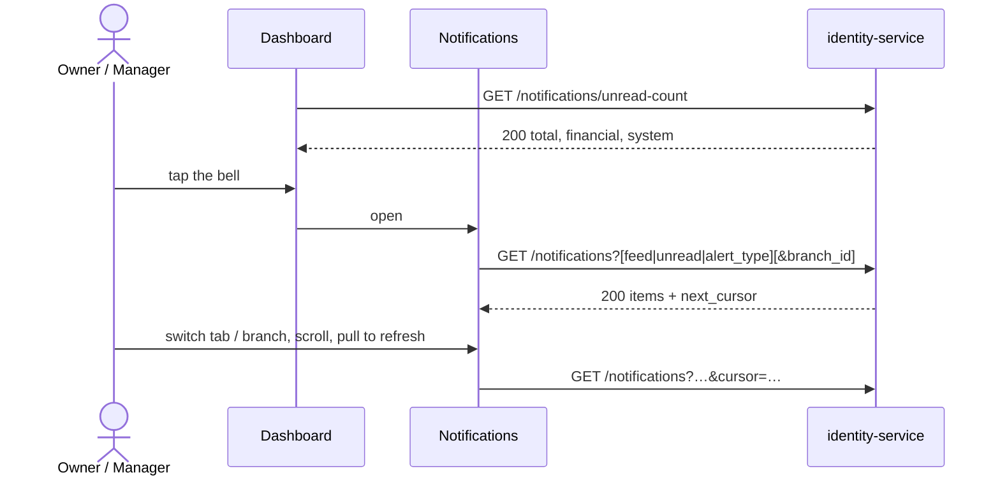
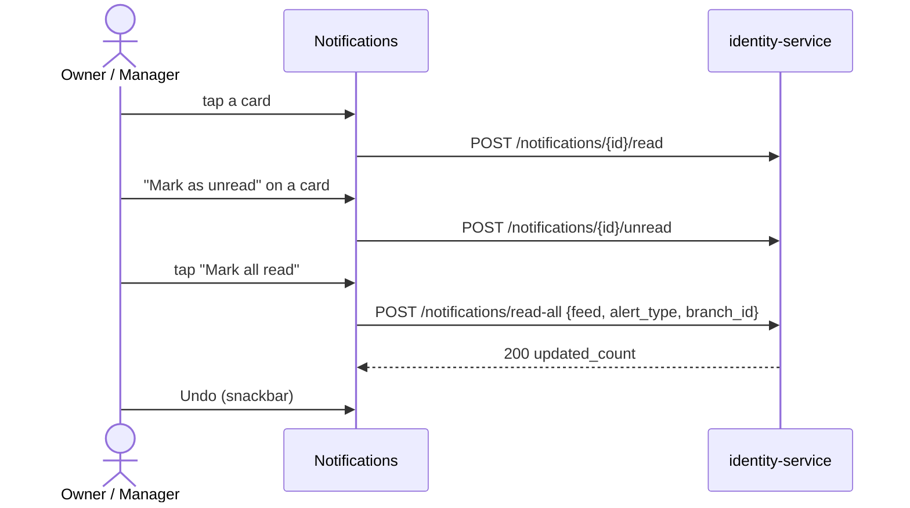
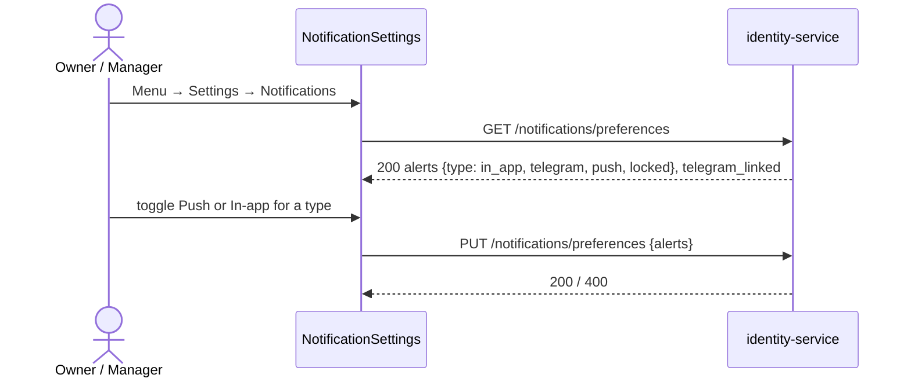
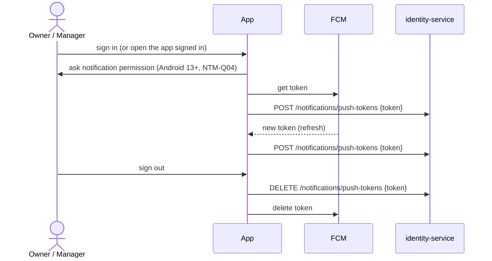
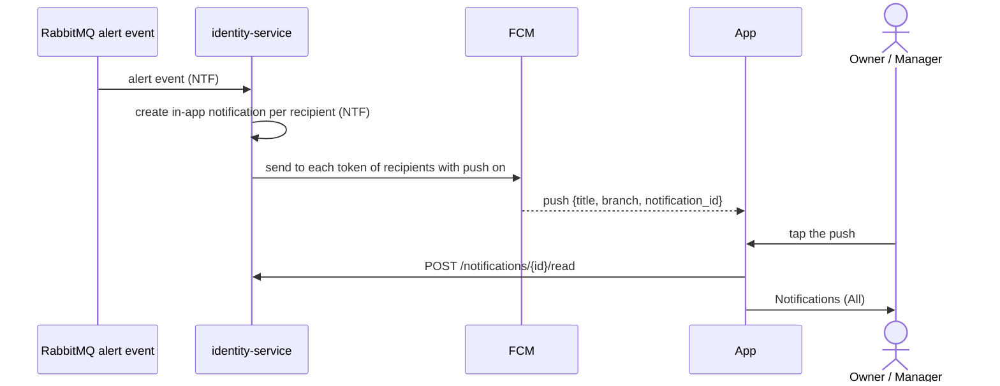

# Spec: Notifications on mobile (center and push)

**Prefix:** `NTM` · **Status:** 📝 Draft · **Version:** v2.4.0 · **Author:** Vuththana
**Tables:** `notifications`, `users.notification_preferences` (identity-service; not yet in the data dictionary — see §8), new `push_tokens` (§8)
**Endpoints:** identity-service `/api/v1/notifications/**` (exist in code, not yet in `api/`) · new ones listed in §9
**Routes (Android destinations):** `Notifications` (owner, manager) · `NotificationSettings` (owner, manager)

<!--
HOW TO WRITE THIS FILE (delete nothing below; replace the <placeholders>)
- Status is one of: 📝 Draft · ✅ Approved · ⟳ Amending. Only /sdd:clarify sets ✅; only /sdd:amend sets ⟳.
- An ID is DEFINED where it starts a list item or table row in bold: `- **XXX-R01** …` or `| **XXX-D01** | …`.
  Anywhere else, write it plain (XXX-R01) — that's a reference. sddtool.py relies on this.
- IDs are never renumbered or reused. Withdraw by striking through: `- ~~**XXX-R07**~~ withdrawn in v5.3.0 — <why>`.
- One requirement = one testable sentence: who, when, what happens, which message. Long rules get several IDs.
- Values (limits, lengths, enums) come from the data dictionary. Quote the field, don't restate its type.
- Section numbers (§1 … §10, and §4a, §4b …) are stable once approved: other docs link to them.
-->

## 1. Summary and scope

Owners and branch managers already get in-app, email and Telegram alerts (overdue invoices, low stock, unmatched bank
lines, reviews to sign off …) from identity-service, but only the web app shows them. This feature brings them to the
Android app: a notification center reached from the Dashboard bell, a per-type notification settings screen, and push
notifications on the phone. The center and settings use the existing identity-service notification API; push is new
and adds device-token storage and an FCM sender in identity-service.

- **In:** Dashboard bell with unread count; notification center (tabs All / Unread / Financial / Stock, owner branch
  filter, day groups, read / unread, mark all read with Undo); notification settings (per alert type: In-app, Push,
  Telegram status); push registration and sign-out unregistration; receiving and opening a push; identity-service
  sending push for the alerts a user has push turned on for.
- **Out:**
  - Which alerts exist, who receives them, their texts, de-duplication and retention: the web spec `notifications`
    (prefix `NTF`), not in this docs repo; this spec cites its rules and the identity-service code.
  - New alert types (e.g. "invoice paid", "review signed off" seen in designs) — a later NTF change (NTM-D06).
  - Opening the related record (bill, item, statement) from a notification or push (NTM-D04).
  - Linking or unlinking Telegram on mobile (shown read-only, NTM-D05); email delivery settings.
  - iOS, the web app's push, notification sounds per type, quiet hours.
- **Depends on:** Android sign-in and session (`auth`), the team's app shell (Dashboard, Menu → Settings), the
  `NTF` rules for recipients and branch scope (NTF-R25 … NTF-R29), in-app lock (NTF-D09) and owner branch filter
  (NTF-R73) as implemented in identity-service.

## 2. Roles and branch scope

| Role | Can | Scope |
|---|---|---|
| `BUSINESS_OWNER` | See and read notifications, mark all read, change notification settings, receive push | Everything the server sends them; can filter the center by one branch or "All branches" |
| `BRANCH_MANAGER` | Same | Only what the server sends them (their own branch and business-wide alerts, NTF-R25 … NTF-R29); no branch filter |

- Scope is enforced by identity-service: the list, counts and read actions only ever touch the caller's own
  notifications; a manager's `branch_id` filter is ignored by the server. The app never sends another user's id.
- Which alert types a role receives comes from the server (`AlertType`: owner / manager flags); the settings screen
  lists exactly the types the server returns for the caller.
- Business-wide notifications have no branch (`branch` null) and show "All branches" (NTM-R07).
- A deactivated user or a deleted business loses their push tokens and gets no push (NTM-R33).

## 3. Decisions

| ID | Topic | Decision |
|---|---|---|
| **NTM-D01** | Scope | One mobile spec for the notification center, notification settings and push. Server-side alert rules stay in NTF and are cited, not copied. (User, 2026-11-16) |
| **NTM-D02** | Tabs | All / Unread / Financial / Stock as in Figma 18.21: Unread = `unread=true`, Financial = `feed=FINANCIAL`, Stock = `alert_type=STOCK` (a stock alert also appears under Financial). No API change. (User, 2026-11-16) |
| **NTM-D03** | Push per type | Push is a third channel per alert type next to In-app and Telegram, chosen by the user in the settings screen and stored with the existing preferences. (User, 2026-11-16) |
| **NTM-D04** | Tapping | Tapping a notification card marks it read; tapping a push opens the notification center and marks that notification read. Neither opens the related record in this version. (User, 2026-11-16) |
| **NTM-D05** | Settings on mobile | Menu → Settings → Notifications lists the caller's alert types with In-app (shown locked on where the server locks it, NTF-D09), Push, and Telegram as a read-only status ("Set up on the web" when not linked). (User, 2026-11-16) |
| **NTM-D06** | Alert types | The app shows the alert types the server sends; an unknown future type is shown with its `message` and a generic icon and title. Missing types from the design are a later NTF change. (User, 2026-11-16) |
| **NTM-D07** | Push text | A push shows only the alert type's title and the branch name ("All branches" for business-wide), never amounts, names or the `message`, because it can appear on a locked screen. (User, 2026-11-16) |
| **NTM-D08** | Unread count | The Dashboard bell shows the unread total from `GET /notifications/unread-count`, refreshed when the Dashboard opens, when the app returns to the foreground and when a push arrives while the app is open. (User, 2026-11-16) |
| **NTM-D09** | Devices | A user may receive push on several phones. Signing in registers the phone's token for that user; signing out unregisters it; the server drops tokens FCM reports as invalid and all tokens of a deactivated user. (User, 2026-11-16) |
| **NTM-D10** | Mark all read | "Mark all read" acts at once, without confirmation, and offers Undo in a snackbar (NTM-Q03 for what Undo restores). (User, 2026-11-16) |
| **NTM-D11** | Branch filter | Proposal: the owner's center has a branch chip ("All branches" + active branches) sent as `branch_id`; every card shows its branch. A manager has no chip. (User chose "per NTF scope", 2026-11-16) |
| **NTM-D12** | Mark all and tabs | Proposal: "Mark all read" applies to the current tab and the owner's branch filter (`feed`, `alert_type`, `branch_id` of `POST /read-all`); on All and Unread it marks everything in the branch filter. |
| **NTM-D13** | Push while open | Proposal: a push that arrives while the app is in the foreground shows no system banner; it refreshes the bell count and, if the center is open, its first page. |
| **NTM-D14** | Endpoints for tokens | Proposal: identity-service adds `POST /api/v1/notifications/push-tokens` (register or refresh, idempotent per token) and `DELETE /api/v1/notifications/push-tokens` (unregister one token), both for the signed-in user only. |
| **NTM-D15** | Offline sign-out | Proposal: on sign-out the app first calls `DELETE /push-tokens`; it then always deletes the phone's FCM token locally, so a token the server still holds becomes invalid and is dropped on the next send (NTM-R32). |
| **NTM-D16** | Firebase config | Proposal: the app's Firebase client file and the server's service-account key are per-environment and never committed: the app reads its file from a git-ignored location, identity-service reads the key from `.env` (TEAM-RULES secrets rule). |

## 4. Journeys

> Diagrams are Mermaid. All server steps go through the API Gateway (`/api/v1/...`) with the user's token.

### 4a. See notifications

Realises NTM-R01 … NTM-R12.

### 4b. Read, unread and mark all

Realises NTM-R13 … NTM-R18.

### 4c. Notification settings

Realises NTM-R19 … NTM-R24.

### 4d. Register the phone for push

Realises NTM-R25 … NTM-R29.

### 4e. Receive and open a push

Realises NTM-R30 … NTM-R37.

## 5. Requirements

### Notification center (§4a)

- **NTM-R01** · Owner, Manager · §4a — The Dashboard header shows a bell button with the unread total from `GET /notifications/unread-count` as a badge (hidden at 0, "99+" above 99); tapping it opens the notification center (NTM-D08).
- **NTM-R02** · Owner, Manager · §4a — The unread count is reloaded when the Dashboard opens, when the app returns to the foreground and when a push arrives while the app is open; a failed reload keeps the last count.
- **NTM-R03** · Owner, Manager · §4a — The notification center shows the tabs All, Unread, Financial and Stock; Unread shows the unread total next to its label; each tab loads `GET /notifications` with its filter (NTM-D02).
- **NTM-R04** · Owner · §4a — An owner can filter the center by one active branch or "All branches" (the start value), sent as `branch_id`; a manager sees no branch filter (NTM-D11).
- **NTM-R05** · Owner, Manager · §4a — Notifications are listed newest first in groups by local day of `created_at` (Asia/Phnom_Penh), headed "Today · {d MMM}", "Yesterday · {d MMM}" or "{d MMM yyyy}".
- **NTM-R06** · Owner, Manager · §4a — Each card shows the alert type's icon and title (NTM-M10 … NTM-M21), the `message` in full, the local time ("HH:mm" today, else "d MMM, HH:mm") and the branch.
- **NTM-R07** · Owner, Manager · §4a — The branch on a card is `branch.branch_name`, "All branches" when `branch` is null, and is marked "(inactive)" when `branch.is_active` is false.
- **NTM-R08** · Owner, Manager · §4a — An unread card is visibly marked (dot and tinted background); a read card is not.
- **NTM-R09** · Owner, Manager · §4a — The list loads the next page with `cursor` = the last `next_cursor` when the user scrolls to the end, until `next_cursor` is null.
- **NTM-R10** · Owner, Manager · §4a — Pull-to-refresh reloads the first page of the current tab and the unread count.
- **NTM-R11** · Owner, Manager · §4a — A tab with no notifications shows NTM-M01 (All, Financial, Stock) or NTM-M02 (Unread).
- **NTM-R12** · Owner, Manager · §4a — An alert type the app doesn't know is shown with a generic icon, the title NTM-M21 and its `message` (NTM-D06).

### Read, unread and mark all (§4b)

- **NTM-R13** · Owner, Manager · §4b — Tapping an unread card marks it read at once on screen and sends `POST /notifications/{id}/read`; on failure the card returns to unread and NTM-M03 shows.
- **NTM-R14** · Owner, Manager · §4b — Each read card offers "Mark as unread", which sends `POST /notifications/{id}/unread` and marks the card unread; on failure it returns to read and NTM-M03 shows.
- **NTM-R15** · Owner, Manager · §4b — The top bar's "Mark all read" sends `POST /notifications/read-all` with the current tab's `feed` or `alert_type` and the owner's `branch_id`, marks the affected cards read and shows NTM-M04 with Undo; it is disabled when the current view has no unread notification (NTM-D10, NTM-D12).
- **NTM-R16** · Owner, Manager · §4b — Undo restores the notifications that "Mark all read" changed to unread (scope per NTM-Q03) and shows NTM-M05 when it can't.
- **NTM-R17** · Owner, Manager · §4b — Every read, unread or mark-all action reloads the unread count, so the Unread tab label and the Dashboard badge stay in step.
- **NTM-R18** · Owner, Manager · §4b — Tapping a card does nothing besides marking it read (NTM-D04).

### Notification settings (§4c)

- **NTM-R19** · Owner, Manager · §4c — Menu → Settings shows "Notifications", which opens the notification settings screen with the alert types returned by `GET /notifications/preferences`, each with its title (NTM-M10 … NTM-M20).
- **NTM-R20** · Owner, Manager · §4c — Each type has an In-app switch, shown on and disabled when the server marks it `locked` (NTF-D09), and a Push switch.
- **NTM-R21** · Owner, Manager · §4c — The screen shows Telegram per type as "On" / "Off" and, when `telegram_linked` is false, the note NTM-M06; Telegram can't be changed on mobile (NTM-D05).
- **NTM-R22** · Owner, Manager · §4c — Changing a switch saves at once with `PUT /notifications/preferences` carrying every type's `in_app`, `telegram` and `push`; on failure the switch returns to its previous value and NTM-M03 or the server message shows.
- **NTM-R23** · Owner, Manager · §4c — When the phone blocks notifications for the app, the screen shows NTM-M07 with "Open settings" (the phone's app notification settings) above the list; Push switches stay editable.
- **NTM-R24** · Owner, Manager · §4c — A type's Push switch has an effect only for alerts the user receives in-app; when In-app is off for a type, no push is sent for it.

### Push registration (§4d)

- **NTM-R25** · Owner, Manager · §4d — After sign-in, and on every app start while signed in, the app sends the phone's FCM token with `POST /notifications/push-tokens`; it sends it again whenever FCM issues a new token (NTM-D09, NTM-D14).
- **NTM-R26** · Owner, Manager · §4d — On Android 13 and later the app asks for the notification permission at the moment set by NTM-Q04, at most once per install unless the user opens it from the settings screen; denying it keeps in-app notifications working.
- **NTM-R27** · Owner, Manager · §4d — A failed token registration is retried on the next app start or token refresh and never shows an error to the user.
- **NTM-R28** · Owner, Manager · §4d — Signing out sends `DELETE /notifications/push-tokens` for the phone's token and then deletes the FCM token on the phone, whether or not the call succeeded (NTM-D15).
- **NTM-R29** · Owner, Manager · §4d — After a sign-out, the next user who signs in on the same phone registers a new token for themselves; the previous user gets no more pushes on that phone.

### Sending and opening push (§4e)

- **NTM-R30** · Server · §4e — When identity-service creates an in-app notification for a recipient (NTF), it sends one push to each of that recipient's tokens if push is on for that alert type (NTM-D03).
- **NTM-R31** · Server · §4e — The push carries the alert type's title (NTM-M10 … NTM-M20) as its title, the branch name or "All branches" as its text, and `notification_id` and `alert_type` as data; no amounts, names or `message` (NTM-D07).
- **NTM-R32** · Server · §4e — A token FCM reports as unregistered or invalid is deleted.
- **NTM-R33** · Server · §4e — Deactivating a user or deleting a business deletes all their tokens; no push is sent to them afterwards.
- **NTM-R34** · Server · §4e — A failed or slow push never delays or blocks creating the in-app notification or the other channels.
- **NTM-R35** · Owner, Manager · §4e — Tapping a push opens the notification center on All and marks that notification read (`POST /notifications/{id}/read`); if the app was signed out, it opens sign-in first and then the center.
- **NTM-R36** · Owner, Manager · §4e — A push that arrives while the app is in the foreground shows no system banner, reloads the unread count and, when the center is open, its first page (NTM-D13).
- **NTM-R37** · Owner, Manager · §4e — Pushes appear in one Android notification channel named NTM-M08.

### Common

- **NTM-R38** · Owner, Manager · all — Every screen shows a loading state; a failed load shows NTM-M03 (connection) or the server message with Retry.
- **NTM-R39** · Owner, Manager · all — Every user-visible string is an Android string resource (English only for now).

### Fields

| Field | Rule | Requirement |
|---|---|---|
| `notifications.notification_id` | read only; id for read / unread and the push data | NTM-R13, NTM-R31 |
| `notifications.feed` | `FINANCIAL` / `SYSTEM` (server) | NTM-R03 |
| `notifications.alert_type` | the server's `AlertType` values | NTM-R06, NTM-R12 |
| `notifications.message` | server text, shown in full | NTM-R06 |
| `notifications.is_read`, `read_at` | server state | NTM-R08, NTM-R13 |
| `notifications.created_at` | UTC; shown in Asia/Phnom_Penh | NTM-R05 |
| `notifications.branch_id` | null = business-wide | NTM-R07 |
| `users.notification_preferences` | per type `in_app`, `telegram`, new `push` (§8) | NTM-R20, NTM-R22 |
| `push_tokens.token` | new (§8) | NTM-R25 |

## 6. Messages

| ID | HTTP · code | Text (English; Khmer later) | Used by |
|---|---|---|---|
| **NTM-M01** | — | "No notifications yet." | NTM-R11 |
| **NTM-M02** | — | "You're all caught up." | NTM-R11 |
| **NTM-M03** | connection error | "Can't reach the server. Check your connection and try again." | NTM-R13, NTM-R14, NTM-R22, NTM-R38 |
| **NTM-M04** | `200` read-all | "{n} marked as read" · action "Undo" | NTM-R15 |
| **NTM-M05** | — | "Couldn't undo. Mark them unread one by one." | NTM-R16 |
| **NTM-M06** | — | "Telegram isn't linked. Set it up on the web." | NTM-R21 |
| **NTM-M07** | — | "Notifications are off for CamFinSight on this phone." · action "Open settings" | NTM-R23 |
| **NTM-M08** | — | Channel name "Alerts" | NTM-R37 |
| **NTM-M09** | `404 · NOT_FOUND` | "This notification is no longer available." | NTM-E06 |
| **NTM-M10** | — | `DUE_DATE` title — Proposal: "Payment due" | NTM-R06, NTM-R31 |
| **NTM-M11** | — | `STOCK` — Proposal: "Stock running low" | NTM-R06, NTM-R31 |
| **NTM-M12** | — | `IMPORT` — Proposal: "Import finished" | NTM-R06, NTM-R31 |
| **NTM-M13** | — | `MONTHLY_REPORT` — Proposal: "Monthly report ready" | NTM-R06, NTM-R31 |
| **NTM-M14** | — | `UNMATCHED_LINES` — Proposal: "Bank lines unmatched" | NTM-R06, NTM-R31 |
| **NTM-M15** | — | `INTEGRATION_FAILURE` — Proposal: "Integration stopped syncing" | NTM-R06, NTM-R31 |
| **NTM-M16** | — | `REVENUE_DRIFT` — Proposal: "Revenue is off its usual pace" | NTM-R06, NTM-R31 |
| **NTM-M17** | — | `BUDGET_EXCEEDED` — Proposal: "Budget exceeded" | NTM-R06, NTM-R31 |
| **NTM-M18** | — | `REVIEW_SUBMITTED` — Proposal: "Reconciliation to sign off"; `REVIEW_RETURNED` — Proposal: "Reconciliation returned" | NTM-R06, NTM-R31 |
| **NTM-M19** | — | `CATEGORY_REQUEST` — Proposal: "Category requested" | NTM-R06, NTM-R31 |
| **NTM-M20** | — | `DAILY_SALES` — Proposal: "Daily sales summary" | NTM-R06, NTM-R31 |
| **NTM-M21** | — | Unknown type — "Notification" | NTM-R12 |

## 7. Edge cases

- **NTM-E01** · Connectivity — The center opens with no connection → loading, then NTM-M03 with Retry; nothing cached is shown.
- **NTM-E02** · Connectivity — Loading the next page fails while earlier cards are shown → the cards stay and the list end shows NTM-M03 with Retry.
- **NTM-E03** · Connectivity — Marking a card read fails → the card returns to unread and NTM-M03 shows (NTM-R13).
- **NTM-E04** · Connectivity — "Mark all read" fails → nothing changes on screen and NTM-M03 shows; no Undo is offered.
- **NTM-E05** · Concurrency — The user reads notifications on the web or another phone → the center and bell show it after the next reload (refresh, tab switch, resume, push).
- **NTM-E06** · State — A notification on screen was purged on the server (read more than 90 days ago, NTF) and the user acts on it → `404`; the card is removed and NTM-M09 shows.
- **NTM-E07** · State — A notification belongs to a branch that is now inactive → it stays listed with "(inactive)" after the branch name (NTM-R07); an inactive branch is not offered in the owner's filter.
- **NTM-E08** · Permissions — A manager is moved to another branch → the center shows what the server now returns; old branch alerts the server still sends remain (NTF rules).
- **NTM-E09** · Permissions — A manager's app sends a `branch_id` → the server ignores it (NTF-R73); the app never sends one for a manager (NTM-R04).
- **NTM-E10** · Data — An unknown `alert_type` arrives → generic icon, title NTM-M21 and its `message` (NTM-R12); a push for it uses the title NTM-M21.
- **NTM-E11** · Data — A very long `message` → shown in full on the card, wrapping; nothing is cut.
- **NTM-E12** · Time — A notification created at 23:30 local time appears under that local day, not the UTC day (NTM-R05).
- **NTM-E13** · Empty — The Unread tab after everything is read → NTM-M02; "Mark all read" is disabled.
- **NTM-E14** · Actions — The user taps "Mark all read" twice quickly → one request; the second tap is ignored while the first is sending.
- **NTM-E15** · Actions — The user taps Undo after the snackbar is gone, or leaves the screen → no Undo; the notifications stay read.
- **NTM-E16** · Push — The phone has the notification permission denied → no system notification shows; the bell count and center still work (NTM-R26).
- **NTM-E17** · Push — Android 12 or earlier → no permission prompt; pushes show unless the user turned the app's notifications off in the phone's settings.
- **NTM-E18** · Push — The user taps a push while signed out → sign-in, then the center; the notification is marked read only if it belongs to the user who signed in, else NTM-M09 is not shown and the center opens normally.
- **NTM-E19** · Push — The user taps a push for a notification that was already read or purged → the center opens; a `404` on the read call is ignored.
- **NTM-E20** · Push — Signing out with no connection → the `DELETE` fails, the phone's FCM token is deleted anyway, and the server drops the stale token on its next send (NTM-R28, NTM-R32).
- **NTM-E21** · Push — FCM issues a new token while the app runs → it is registered at once (NTM-R25); the old one is dropped by the server when FCM reports it invalid.
- **NTM-E22** · Push — The same user is signed in on two phones → both receive the push; reading it on one phone doesn't remove the system notification on the other.
- **NTM-E23** · Push — A user turns Push off for a type while a push for it is already on the way → that push may still arrive; later ones don't.
- **NTM-E24** · Push — The app is killed when a push is tapped → the app starts, restores the session and opens the center (NTM-R35).
- **NTM-E25** · Push — FCM is unreachable from identity-service → the in-app notification and Telegram are delivered as usual; that push is lost (NTM-R34).
- **NTM-E26** · Settings — Saving a switch fails → the switch returns to its old value and NTM-M03 shows (NTM-R22).
- **NTM-E27** · Settings — The server returns a type with `locked` true → its In-app switch shows on and can't be changed (NTM-R20).
- **NTM-E28** · Session — The token expires while the center is open → the existing refresh runs; if it fails, sign-in, and the token is unregistered as on sign-out.

## 8. Data dictionary changes

| Table.field | Change | Why | State |
|---|---|---|---|
| `notifications` (all columns) | Add the table to `data-dictionary/` as it is in identity-service V1 (owned by NTF) | Fields cited in §5 | proposed |
| `users.notification_preferences` | jsonb shape gains `push` (boolean) per alert type next to `in_app` and `telegram`; default per NTM-Q02 | NTM-R20, NTM-R22, NTM-R30 | proposed |
| `push_tokens` | New identity-service table: `push_token_id` (uuid, PK), `user_id` (FK `users`, not null), `token` (text, not null, unique), `platform` (`ANDROID`), `created_at`, `last_seen_at` | NTM-R25, NTM-R28, NTM-R32, NTM-R33 | proposed |

## 9. Endpoints

| Method · path | Service | Who | Requirements | In api/? |
|---|---|---|---|---|
| `GET /api/v1/notifications` | identity-service | Owner, Manager | NTM-R03 … NTM-R12 | 📝 exists in code, not yet listed |
| `GET /api/v1/notifications/unread-count` | identity-service | Owner, Manager | NTM-R01, NTM-R02, NTM-R17 | 📝 exists in code, not yet listed |
| `POST /api/v1/notifications/{notification_id}/read` | identity-service | Owner, Manager | NTM-R13, NTM-R35 | 📝 exists in code, not yet listed |
| `POST /api/v1/notifications/{notification_id}/unread` | identity-service | Owner, Manager | NTM-R14, NTM-R16 | 📝 exists in code, not yet listed |
| `POST /api/v1/notifications/read-all` | identity-service | Owner, Manager | NTM-R15 | 📝 exists in code, not yet listed |
| `GET /api/v1/notifications/preferences` | identity-service — **changed** (adds `push`) | Owner, Manager | NTM-R19 … NTM-R21 | 📝 planned |
| `PUT /api/v1/notifications/preferences` | identity-service — **changed** (accepts `push`) | Owner, Manager | NTM-R22 | 📝 planned |
| `POST /api/v1/notifications/push-tokens` | identity-service — **new** | Owner, Manager | NTM-R25, NTM-R27 | 📝 planned |
| `DELETE /api/v1/notifications/push-tokens` | identity-service — **new** | Owner, Manager | NTM-R28 | 📝 planned |
| `GET /api/v1/branches` | identity-service | Owner | NTM-R04 | 📝 exists in code (see `mobile-sales-management`) |

Push sending runs inside identity-service where alerts are fanned out (`AlertEventListener`, next to Telegram delivery); FCM is called only by identity-service.

## 10. Questions

- **NTM-Q01** · §1 — Who owns the Firebase project and where do the app's client file and the server key live for each environment (local, dev, prod)? *Options:* (a) one team Firebase project with dev and prod apps, files handed out like `.env` — simple; (b) a project per environment — cleaner separation, more setup. *Suggested:* (a), per NTM-D16.
- **NTM-Q02** · §8 — Default of the new Push switch for existing and new users? *Options:* (a) on for every type the user receives in-app — they get push right away; (b) the same as each type's Telegram default (NTF) — urgent types only; (c) off for all — the user opts in. *Suggested:* (b).
- **NTM-Q03** · §4b — What does Undo after "Mark all read" restore? `read-all` returns only a count. *Options:* (a) the unread notifications the app had loaded, marked unread one by one — no server change, older ones stay read; (b) a server change: `read-all` returns the changed ids (or accepts them back) so Undo restores exactly those — accurate, needs identity work. *Suggested:* none; (a) is cheaper, (b) is exact.
- **NTM-Q04** · §4d — When does the app ask for the notification permission (Android 13+)? *Options:* (a) on the Dashboard right after the first sign-in — most users allow it; (b) only when the user turns a Push switch on — fewer prompts, fewer pushes; (c) on first sign-in with a short explanation screen first. *Suggested:* (a).
