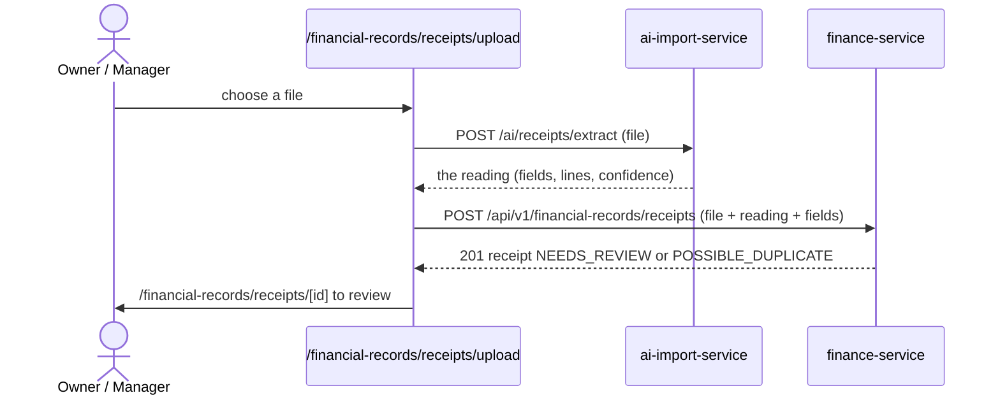
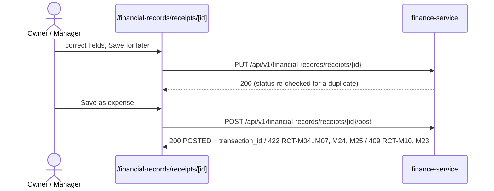

# Spec: Receipts

**Prefix:** `RCT` · **Status:** ⟳ Amending · **Version:** v5.0.0 · **Author:** Vuththana
**Tables:** [`receipts`](../../data-dictionary/finance.md#receipts), [`receipt_lines`](../../data-dictionary/finance.md#receipt_lines), [`documents`](../../data-dictionary/finance.md#documents) · reads `financial_accounts`, `business_categories`, `transactions`, `bank_transactions`, `change_logs`
**Endpoints:** [api/finance-service.md](../../api/finance-service.md) · listed in §9
**Routes:** `/financial-records/receipts` (Owner, Manager) · `/financial-records/receipts/upload` (Owner, Manager) · `/financial-records/receipts/new` (Owner, Manager) · `/financial-records/receipts/[id]` (Owner, Manager)

## 1. Summary and scope

A shop pays for small things every day (supplies, repairs, fuel) and keeps a paper receipt. Today the owner or branch
manager can have AI read a receipt photo in the web app, but finance-service can't save it, so the receipt is lost and
the expense has to be typed again as a transaction. This feature saves receipts in finance-service: from an AI-read
photo or PDF, or typed in by hand. The user checks the fields, the system warns about a possible duplicate, and the
receipt is posted as one expense transaction. A posted receipt is never edited or deleted; it is reversed.

- **In:** upload a receipt file with its AI reading and save it for review; type in a receipt with no file; list,
  filter and count receipts; open one with its lines, file and history; edit an unposted receipt; resolve a possible
  duplicate; post as an expense; discard an unposted receipt; reverse a posted receipt.
- **Out:**
  - CSV export of the list: its own change later (RCT-D21).
  - The AI reading itself: `POST /ai/receipts/extract` on the AI & Import service. The web calls it, then sends the
    result here (RCT-D03).
  - Bank reconciliation of the posted expense. The existing reconciliation flow matches it like any other transaction;
    this spec only shows its state (RCT-R40).
  - Mobile (Android) screens.
- **Depends on:** financial accounts, business categories and the transaction ledger (posting and reversal) as built in
  finance-service, whose reverse, PATCH and categorize endpoints change for receipt transactions (RCT-R47, RCT-R48, RCT-R52, RCT-R53); `businesses.exchange_rate` read from identity-service; `POST /ai/receipts/extract` on ai-import-service,
  called by the web. None has a spec in this docs version, so their rules are named by table and field.

## 2. Roles and branch scope

| Role | Can | Scope |
|---|---|---|
| `BUSINESS_OWNER` | Everything in this spec | All branches, or one when switched |
| `BRANCH_MANAGER` | Everything in this spec | Locked to `users.branch_id` |

- A receipt belongs to one branch once it has an account (RCT-R12). Before that its branch is the creator's: a
  manager's own branch, or the owner's picked branch, or none for an owner on "All branches" (RCT-R04).
- An owner sees receipts of every branch and those with no branch yet. A manager sees only receipts of their branch
  (RCT-R30).
- Business-wide accounts (`financial_accounts.branch_id` null) can pay for a receipt; a branch then has to be chosen
  (RCT-R13).
- A deactivated user's receipts stay. Who created a receipt is kept in `receipts.created_by_user_id`.
- Discarded receipts are deleted (RCT-D05); nothing is soft-deleted.

## 3. Decisions

| ID | Topic | Decision |
|---|---|---|
| **RCT-D01** | Scope of the spec | A standalone `receipts` spec. The web code cites a financial-records (FRC) spec for receipts, which isn't in these docs (answered 2026-11-16 by Vuththana). |
| **RCT-D02** | Roles | Owner and Manager both use every action; the manager only in their own branch (answered 2026-11-16 by Vuththana). |
| **RCT-D03** | Where the file and reading live | finance-service owns `receipts`, `receipt_lines` and `documents`. The web calls AI extract, then sends the file and the reading to finance-service in one request. The file is stored in RustFS (S3) under a per-business key; the reading goes in `documents.extraction` (answered 2026-11-16 by Vuththana). |
| **RCT-D04** | Statuses | `NEEDS_REVIEW`, `POSSIBLE_DUPLICATE`, `POSTED`, `REVERSED` (answered 2026-11-16 by Vuththana). |
| **RCT-D05** | Discard | Discarding deletes the receipt, its lines, its `documents` row and the stored file. A `change_logs` row stays (answered 2026-11-16 by Vuththana). |
| **RCT-D06** | Possible duplicate | Same vendor (ignoring case and outer spaces), same receipt date, same total and currency (answered 2026-11-16 by Vuththana). What it is compared against: RCT-Q03. |
| **RCT-D07** | Reversal | Posts one opposite transaction, sets the receipt to `REVERSED`, and requires a reason. It is refused while the expense is matched to a bank statement line (answered 2026-11-16 by Vuththana). |
| **RCT-D08** | Typed-in receipts | Allowed with no file. They post with transaction source `MANUAL_ENTRY`; receipts with a file post with `AI_RECEIPT` (answered 2026-11-16 by Vuththana). |
| **RCT-D09** | Files | JPG, PNG, WebP or PDF, at most 10 MB, the same as the existing attachments endpoint. An unreadable file is still saved, with an empty form (answered 2026-11-16 by Vuththana). |
| **RCT-D10** | Branch and rate at posting | The branch is the account's branch; a business-wide account needs a chosen branch. `exchange_rate` and `usd_equivalent` are set by the server from `businesses.exchange_rate` when the receipt is posted (answered 2026-11-16 by Vuththana). |
| **RCT-D11** | List | Server-side paging, 20 a page, newest `receipt_date` then `created_at` first (answered 2026-11-16 by Vuththana). |
| **RCT-D12** | Receipt code | `RCP-{yyyy}-{seq}`: a per-business yearly counter, like sales-service's `INV-2026-0001` (answered 2026-11-16 by Vuththana). |
| **RCT-D13** | Posted receipts | Read-only; to fix one, reverse it and enter a new one (answered 2026-11-16 by Vuththana). |
| **RCT-D14** | Category field name | receipts use `business_category_id`, as `transactions` do. The web type's `category_id` is renamed to match, and its `created_by` to `created_by_user_id` (answered 2026-11-16 by Vuththana). |
| **RCT-D15** | Save for later | an unposted receipt can be saved with missing or invalid fields; the required-field rules apply only at posting (RCT-R20). This matches the web's "Saved for later" (answered 2026-11-16 by Vuththana). |
| **RCT-D16** | Year of the code | the year in `receipt_code` is the year the receipt is created, in Asia/Phnom_Penh, not the receipt date (answered 2026-11-16 by Vuththana). |
| **RCT-D17** | Shape of the AI reading | `documents.extraction` stores the `POST /ai/receipts/extract` response as is (per field `{value, confidence, source_text}`, `line_items`, `issues`, `overall_confidence`). The AI team confirms the confidence scale in `jsonb-shapes.md` (answered 2026-11-16 by Vuththana). |
| **RCT-D18** | Checking the AI reading | finance-service only checks that the reading is a JSON object of at most 256 KB, and stores it as given (answered 2026-11-16 by Vuththana). |
| **RCT-D19** | Duplicate comparison | A receipt is compared with the business's other receipts that aren't `REVERSED` and with `POSTED` `EXPENSE` transactions that aren't reversed (vendor against `counterparty_name`). An unposted receipt match is kept in a new `duplicate_of_receipt_id` (answered 2026-11-16 by Vuththana). |
| **RCT-D20** | Creator vs branch | A manager can discard or reverse any receipt of their branch, also one the owner created; scope is by branch, not creator (answered 2026-11-16 by Vuththana). |
| **RCT-D21** | Export | CSV export is out of this spec and comes in its own change (answered 2026-11-16 by Vuththana). |
| **RCT-D22** | Lines | Lines are optional, at most 100 per receipt; `quantity` and `unit_price` are 0 or more; lines, subtotal, tax and total aren't cross-checked (answered 2026-11-16 by Vuththana). |
| **RCT-D23** | Tax | `tax_amount` is entered as printed; `tax_rate` is optional, 0 to 100, shown only; nothing is computed. `subtotal` and `tax_amount` are 0 or more (answered 2026-11-16 by Vuththana). |
| **RCT-D24** | Two editors | The last save of an unposted receipt wins (answered 2026-11-16 by Vuththana). |
| **RCT-D25** | Ledger | Posting and reversing go through the existing finance ledger, so its rules apply too: a signed-off period (`PERIOD_LOCKED`), one reversal per transaction (answered 2026-11-16 by Vuththana). |
| **RCT-D26** | Branch from account | The account's branch always wins over a sent branch; a sent branch only counts with a business-wide account (answered 2026-11-16 by Vuththana). |
| **RCT-D27** | USD before posting | `exchange_rate` and `usd_equivalent` are null until posting; the summary card converts unposted totals at today's rate (answered 2026-11-16 by Vuththana). |
| **RCT-D28** | Fields copied at posting | Posting also sets the transaction's `description` "Receipt {receipt_code} · {vendor_name}", `attachment` = the file's storage key, and `created_by_user_id` = the poster (answered 2026-11-16 by Vuththana). |
| **RCT-D29** | Rate scale | After posting, the receipt gets the transaction's `exchange_rate` and `usd_equivalent`, at the transaction's scale (`exchange_rate` numeric(10,2)) (answered 2026-11-16 by Vuththana). |
| **RCT-D30** | Currency | The receipt's currency must be the account's currency, else `ACCOUNT_CURRENCY_MISMATCH` (answered 2026-11-16 by Vuththana). |
| **RCT-D31** | Orphaned files | A stored file left without a receipt is logged with its key and cleaned by hand; no job in this release (answered 2026-11-16 by Vuththana). |
| **RCT-D32** | Retried upload | A retried upload creates a second receipt; the duplicate check flags it. No idempotency key (answered 2026-11-16 by Vuththana). |
| **RCT-D33** | List shape | The list uses finance's existing paging: `page` (from 0) and `size` (default 20, clamped to 1–200 like other finance lists), answering `{items, page, size, total_elements, total_pages}` (answered 2026-11-16 by Vuththana). |
| **RCT-D34** | Category errors | An inactive category gets `CATEGORY_INACTIVE`; a category that isn't `EXPENSE` gets `CATEGORY_TYPE_MISMATCH`, as finance does today (answered 2026-11-16 by Vuththana). |
| **RCT-D35** | Incomplete posting | Missing fields, a missing branch and a total of 0 or less all come back together as one `RECEIPT_INCOMPLETE` with every problem listed (answered 2026-11-16 by Vuththana). |
| **RCT-D36** | Inactive branch | Receipts of a deactivated branch can still be changed, as other finance records today; a branch rule for all of finance belongs in its own change (answered 2026-11-16 by Vuththana). |
| **RCT-D37** | Duplicate outside a manager's branch | The check stays business-wide; a manager whose receipt matches another branch's expense sees a warning with no link or details of the match (answered 2026-11-16 by Vuththana). |
| **RCT-D38** | A receipt's transaction elsewhere | The transactions endpoints refuse to reverse or PATCH a transaction that a receipt points to; it is changed only from its receipt, which keeps RCT-D13 true. The code `TRANSACTION_NOT_REVERSIBLE` is reused for the PATCH refusal too (answered 2026-11-16 by Vuththana). |
| **RCT-D39** | Losing to a discard | Any action on a receipt that a discard has already removed gets 404 RCT-M08, as for any receipt that isn't there (answered 2026-11-16 by Vuththana). |
| **RCT-D40** | Which duplicate match is kept | Transactions before unposted receipts, then the oldest `created_at`, then the id; for a manager a match in their own branch comes first. A posted receipt and its own transaction count as one match (answered 2026-11-16 by Vuththana). |
| **RCT-D41** | Number search | When the trimmed search is plain `digits[.digits]`, it also matches receipts whose total equals that number (`12.5` = `12.50`) (answered 2026-11-16 by Vuththana). |
| **RCT-D42** | Account turned off | RCT-M06 uses finance's existing text "'{account}' is inactive"; no turned-off date is shown (answered 2026-11-16 by Vuththana). |
| **RCT-D43** | Reversal date | A receipt's reversal is dated today, so an old receipt can still be reversed after its month is signed off; it is refused only when today is in a signed-off period (RCT-R45) (answered 2026-11-16 by Vuththana). |
| **RCT-D44** | Bulk categorize | `POST /bank-statements/transactions/categorize` refuses the whole batch with RCT-M28 when any id is a receipt's transaction; nothing in it changes (answered 2026-11-16 by Vuththana). |
| **RCT-D45** | A receipt's reversal row | The reversal transaction of a receipt's transaction is locked the same way: PATCH and categorize refuse it with RCT-M28 (answered 2026-11-16 by Vuththana). |
| **RCT-D46** | Status in RCT-M09 | `{status}` in RCT-M09 is written in lowercase words, "posted" or "reversed" (the only statuses that reach RCT-M09 after RCT-R54), e.g. "This receipt is posted and can't be changed." Other messages keep their own text (answered 2026-11-16 by Vuththana). |
| **RCT-D47** | Reversing an unposted receipt | Reversing a receipt that isn't `POSTED` gets its own text, RCT-M30 "Only a posted receipt can be reversed.", instead of RCT-M09, with its own code (RCT-D62; RCT-R54 replaces RCT-R39) (answered 2026-11-16 by Vuththana). |
| **RCT-D48** | Amount format in messages | `{amount}` in RCT-M18 has thousands separators; USD with 2 decimals ("1,250.50 USD"), KHR with none ("41,000 KHR") (answered 2026-11-16 by Vuththana). |
| **RCT-D49** | Reversed receipt detail | A `REVERSED` receipt's detail also returns the reference of the transaction it posted; `reconciliation_state` stays null (RCT-R55 replaces RCT-R34) (answered 2026-11-16 by Vuththana). |
| **RCT-D50** | Save with no change | A save that changes no field and no line writes no `change_logs` row (RCT-R56 replaces RCT-R15) (answered 2026-11-16 by Vuththana). |
| **RCT-D51** | Summary without a rate | The summary reads today's rate only when an unposted receipt needs converting; with nothing to convert it answers even when identity-service can't give the rate (RCT-E31) (answered 2026-11-16 by Vuththana). |
| **RCT-D52** | Not-duplicate and edit texts | "Not a duplicate" answers RCT-M29 "Marked as not a duplicate"; an edit (`PUT`) answers RCT-M15 "Receipt saved", as a create does (answered 2026-11-16 by Vuththana). |
| **RCT-D53** | Reason problem codes | RCT-M13 and RCT-M21 carry `data` `[{field: "reason", problem, message}]` with `problem` `REQUIRED` and `TOO_LONG`; `REQUIRED` joins the RCT-M03 problem codes (answered 2026-11-16 by Vuththana). |
| **RCT-D54** | Bad body vs missing receipt | A request body that fails RCT-M03, RCT-M13 or RCT-M21 is refused with 400 before the receipt is looked up, so it gets 400 even for a receipt that would be 404. The 400 is the same whether the receipt exists, so nothing is revealed (refines RCT-D39) (answered 2026-11-16 by Vuththana). |
| **RCT-D55** | Totals when saving | Saving accepts a total or line amount of 0 or less (RCT-D15); posting refuses a total of 0 or less (RCT-R20) (answered 2026-11-16 by Vuththana). |
| **RCT-D56** | Reading without a file | An AI reading sent without a file is checked (RCT-R41) and then not stored, since there is no `documents` row (answered 2026-11-16 by Vuththana). |
| **RCT-D57** | Reversing with a turned-off account or category | Reversing is allowed when the receipt's account or category has since been turned off; the reversal corrects the books (answered 2026-11-16 by Vuththana). |
| **RCT-D58** | Reversal rows and duplicates | A reversal transaction (`reverses_transaction_id` set) is never a duplicate candidate (RCT-R23) (answered 2026-11-16 by Vuththana). |
| **RCT-D59** | Skip after "not a duplicate" | RCT-R10's skip compares the vendor, date, total and currency with the latest `NOT_DUPLICATE` `change_logs` snapshot; if they are unchanged the check is skipped, even when a different record would now match (answered 2026-11-16 by Vuththana). |
| **RCT-D60** | Branch name for a manager | The API returns `branch_name` to both roles; the web shows it to the owner only (RCT-R32) (answered 2026-11-16 by Vuththana). |
| **RCT-D61** | Order of reverse refusals | 400 (RCT-M13, RCT-M21) → 404 (RCT-M08) → RCT-M30 not posted → RCT-M14 matched → RCT-M23 period signed off → RCT-M26 from the ledger (answered 2026-11-16 by Vuththana). |
| **RCT-D62** | Code of RCT-M30 | A new `409 · RECEIPT_NOT_REVERSIBLE`, not `RECEIPT_NOT_EDITABLE` (answered 2026-11-16 by Vuththana). |
| **RCT-D63** | Summary when the rate is missing | When an unposted receipt needs converting and identity-service can't give the rate, the summary still answers: counts as usual, the USD totals that needed the rate are null, and the web shows "—" (RCT-E33) (answered 2026-11-16 by Vuththana). |
| **RCT-D64** | Needs converting | Only unposted receipts whose `original_currency` isn't USD need the rate; unposted USD receipts count as they are (answered 2026-11-16 by Vuththana). |
| **RCT-D65** | Status change on a save | A status or `duplicate_of_*` change caused by the re-check (RCT-R10) counts as a change: it writes an `UPDATED` row and moves `updated_at` (RCT-R56) (answered 2026-11-16 by Vuththana). |
| **RCT-D66** | Skip only while cleared | RCT-R10's skip (RCT-D59) applies only while the receipt is `NEEDS_REVIEW`; once flagged `POSSIBLE_DUPLICATE` again it stays flagged until "Not a duplicate" is pressed again, even if the fields go back (answered 2026-11-16 by Vuththana). |
| **RCT-D67** | Trimming the reason | The reverse `reason` is trimmed before the 1–500 check; a reason of only spaces gets RCT-M13 (answered 2026-11-16 by Vuththana). |
| **RCT-D68** | RCT-M03 problem codes | The `problem` codes are listed under §6 (RCT-M03), with `REQUIRED` added (RCT-D53) (answered 2026-11-16 by Vuththana). |
| **RCT-D69** | Reference of a posted transaction | RCT-R55's reference is the transaction's `reference_number`, or its id when that is empty (as RCT-M16); `transaction_id` is returned too (answered 2026-11-16 by Vuththana). |

## 4. Journeys

> Diagrams are Mermaid. Steps marked *server* are simulated by the web-ui mock until the endpoint exists.

### 4a. Upload a receipt

If AI can't read the file, the web still saves it, with the reading it got (or none) and no fields. The user then
types the fields in. Requirements: RCT-R01 to RCT-R08, RCT-R41 to RCT-R43.

### 4b. Type in a receipt

`/financial-records/receipts/new`. The same form with no file, saved with
`POST /api/v1/financial-records/receipts` and no file part. Requirements: RCT-R01, RCT-R04 to RCT-R08, RCT-R42, RCT-R43, RCT-R57.

### 4c. Review, save for later and post

Requirements: RCT-R09 to RCT-R22, RCT-R44, RCT-R45, RCT-R56.

### 4d. Possible duplicate

On the review page of a `POSSIBLE_DUPLICATE` receipt, the user compares it with the match. Then either:
- "Same expense, discard receipt" (§4f), or
- "Not a duplicate, continue review": `POST .../{id}/not-duplicate`, and the receipt goes to `NEEDS_REVIEW`.

Requirements: RCT-R23 to RCT-R26, RCT-R46, RCT-R49, RCT-R58.

### 4e. List

`/financial-records/receipts` shows the cards, the status tabs, the filters, a page of rows, and a search box.
Requirements: RCT-R30 to RCT-R35, RCT-R40, RCT-R50, RCT-R55.

### 4f. Discard

From an unposted receipt: a confirmation, then `DELETE .../{id}`. Requirements: RCT-R36, RCT-R37.

### 4g. Reverse

From a posted receipt: a reason, then `POST .../{id}/reverse`. Requirements: RCT-R38, RCT-R45, RCT-R47, RCT-R48, RCT-R51 to RCT-R54.

## 5. Requirements

### Upload and type in (§4a, §4b)

- **RCT-R01** · Owner, Manager · §4a — When a receipt is saved, the system creates it with a new `receipt_code` `RCP-{yyyy}-{seq}`, unique per business (RCT-D12, RCT-D16), and returns it with 201.
- **RCT-R02** · Owner, Manager · §4a — A file that isn't JPG, PNG, WebP or PDF is refused with RCT-M01, and a file over 10 MB with RCT-M02; nothing is saved.
- **RCT-R03** · Owner, Manager · §4a — When a file is sent, the system stores it in RustFS under a key private to the business and creates one `documents` row. The row holds the file's name, content type, size, the key, and the AI reading as sent in `documents.extraction` (RCT-D17). `receipts.document_id` points to the row.
- **RCT-R04** · Owner, Manager · §4a — A new receipt's `branch_id` is the manager's branch, the owner's picked branch, or null for an owner on "All branches". A sent `financial_account_id` overrides this (RCT-R12).
- **RCT-R05** · Owner, Manager · §4a — The fields sent with a new receipt are saved as they are, even when incomplete (RCT-D15). Each sent field must still meet its dictionary length and type, or the request is refused with RCT-M03 naming the field.
- **RCT-R06** · Owner, Manager · §4a — A new receipt's status is `POSSIBLE_DUPLICATE` when RCT-R23 finds a match, otherwise `NEEDS_REVIEW`.
- **RCT-R07** · Owner, Manager · §4a — `receipts.created_by_user_id` is the caller and `created_at` is now. A `change_logs` row records the creation.
- **RCT-R08** · Owner, Manager · §4b — A receipt saved with no file has `document_id` null.
- **RCT-R57** · Owner, Manager · §4b — An AI reading sent with no file is checked as RCT-R41 and then not stored; no `documents` row is created (RCT-D56).
- **RCT-R41** · Owner, Manager · §4a — The AI reading must be a JSON object of at most 256 KB, or the request is refused with RCT-M03; its content isn't checked further (RCT-D18).
- **RCT-R42** · Owner, Manager · §4a — A receipt has at most 100 lines, each with `quantity` and `unit_price` of 0 or more; lines, `subtotal`, `tax_amount` and the total are not checked against each other (RCT-D22). Breaking a limit is refused with RCT-M03.
- **RCT-R43** · Owner, Manager · §4a — `tax_amount` and `subtotal` are entered as printed and are 0 or more; `tax_rate` is optional, 0 to 100, and nothing is computed from it (RCT-D23). Breaking a limit is refused with RCT-M03.

### Review and save for later (§4c)

- **RCT-R09** · Owner, Manager · §4c — While a receipt is `NEEDS_REVIEW` or `POSSIBLE_DUPLICATE`, `PUT .../{id}` replaces its fields and its lines with the ones sent, under the same rule as RCT-R05.
- **RCT-R10** · Owner, Manager · §4c — After each save, the duplicate check (RCT-R23) runs again. A receipt marked not a duplicate (RCT-R25) stays `NEEDS_REVIEW` unless the vendor, date, total or currency changed (RCT-D59, RCT-D66).
- **RCT-R11** · Owner, Manager · §4c — Editing a `POSTED` or `REVERSED` receipt is refused with RCT-M09 (RCT-D13).
- **RCT-R12** · Owner, Manager · §4c — When `financial_account_id` is set to an account with a branch, `receipts.branch_id` becomes that branch, whatever branch was sent (RCT-D26).
- **RCT-R13** · Owner, Manager · §4c — With a business-wide account, the receipt keeps the branch sent with it, or the manager's own branch.
- **RCT-R14** · Manager · §4c — A manager can only choose an account of their own branch or a business-wide account; any other is refused with RCT-M11.
- ~~**RCT-R15**~~ withdrawn in v5.0.0 — replaced by RCT-R56 (a save that changes nothing writes no row, RCT-D50).
- **RCT-R56** · Owner, Manager · §4c — Each save that changes at least one field or line, or the status or duplicate match (RCT-D65), writes an `UPDATED` `change_logs` row with the changed fields; a save that changes nothing writes none (RCT-D50).

### Post as an expense (§4c)

- **RCT-R16** · Owner, Manager · §4c — Posting is allowed only from `NEEDS_REVIEW`. A `POSSIBLE_DUPLICATE` receipt is refused with RCT-M10 until it is resolved (RCT-R25); a `POSTED` or `REVERSED` one with RCT-M09.
- **RCT-R17** · Owner, Manager · §4c — Posting creates exactly one `transactions` row through the finance ledger (RCT-D25), with:
  - `transaction_type` `EXPENSE` and status `POSTED`
  - `transaction_date` = `receipt_date`
  - the receipt's total and currency
  - its `financial_account_id`, `business_category_id` and `branch_id`
  - `counterparty_name` = `vendor_name` and `reference_number` = `receipt_number`
  - `source` `AI_RECEIPT` when the receipt has a file, else `MANUAL_ENTRY` (RCT-D08)
  - `description` "Receipt {receipt_code} · {vendor_name}", `attachment` = the file's `storage_key` (null without a file), and `created_by_user_id` = the poster (RCT-D28)
- **RCT-R18** · Owner, Manager · §4c — On posting, the ledger sets the transaction's `exchange_rate` from `businesses.exchange_rate` and its `usd_equivalent`, and the receipt gets the same two values (RCT-D10, RCT-D29). Before posting both are null on the receipt (RCT-D27).
- **RCT-R19** · Owner, Manager · §4c — After posting, the receipt is `POSTED` and its `transaction_id` points to the new transaction. Account balances change as for any posted expense, and a `change_logs` row records it.
- **RCT-R20** · Owner, Manager · §4c — Posting is refused with RCT-M04, naming every missing or invalid field, unless all of these hold:
  - `vendor_name`, `receipt_date`, `original_currency`, `business_category_id` and `financial_account_id` are set
  - the receipt has a `branch_id`
  - the total is more than 0
- **RCT-R21** · Owner, Manager · §4c — Posting is refused with RCT-M05 when `receipt_date` is after today in Asia/Phnom_Penh.
- **RCT-R22** · Owner, Manager · §4c — Posting is refused with RCT-M06 when the account is inactive, with RCT-M07 when the category is inactive, and with RCT-M25 when the category isn't an `EXPENSE` category (RCT-D34).
- **RCT-R44** · Owner, Manager · §4c — Posting is refused with RCT-M24 when the receipt's currency isn't the account's currency (RCT-D30).
- **RCT-R45** · Owner, Manager · §4c — Posting is refused with RCT-M23 when `receipt_date` falls in a period the account is signed off for, and reversing when today does, as for any ledger entry (RCT-D25).

### Possible duplicate (§4d)

- **RCT-R23** · Owner, Manager · §4d — A receipt is a possible duplicate when, in the same business, another receipt that isn't `REVERSED`, or a `POSTED` `EXPENSE` transaction that isn't reversed and isn't this receipt's own, has the same vendor (`vendor_name` or `counterparty_name`, case-insensitive, trimmed), the same date, and the same total and currency (RCT-D06, RCT-D19).
- **RCT-R58** · Owner, Manager · §4d — A reversal transaction (`reverses_transaction_id` set) is never a duplicate candidate (RCT-D58).
- **RCT-R24** · Owner, Manager · §4d — When the match is a transaction, `receipts.duplicate_of_transaction_id` holds it; when it is an unposted receipt, `receipts.duplicate_of_receipt_id` holds it (a posted receipt counts as its transaction). The review page links to the match when the caller may see it.
- **RCT-R46** · Manager · §4d — When the match (a receipt or a transaction) is outside the manager's branch or has no branch, the receipt is still `POSSIBLE_DUPLICATE`, but the detail shows only `duplicate_match_scope` = `OTHER_BRANCH`, with no id, vendor or amount of the match, and the review page shows RCT-M27. Posting it is refused with RCT-M10 until it is marked not a duplicate or discarded (RCT-D37).
- **RCT-R49** · Owner, Manager · §4d — When several records match, the one stored is: for a manager, first one in their own branch; then a transaction before an unposted receipt; then the oldest `created_at`; then the lowest id. A posted receipt and its own transaction count as one match (RCT-D40).
- **RCT-R25** · Owner, Manager · §4d — "Not a duplicate" (`POST .../{id}/not-duplicate`) on a `POSSIBLE_DUPLICATE` receipt sets it to `NEEDS_REVIEW` and clears `duplicate_of_transaction_id` and `duplicate_of_receipt_id`. It records `NOT_DUPLICATE` in `change_logs` with a snapshot of `vendor_name`, `receipt_date`, `original_amount` and `original_currency` (RCT-D59), and answers RCT-M29; no reason is asked.
- **RCT-R26** · Owner, Manager · §4d — "Not a duplicate" on any other status is refused with RCT-M12.

### List (§4e)

- **RCT-R30** · Owner, Manager · §4e — `GET /receipts` returns only receipts in the caller's scope (§2), paged with `page` and `size` (default 20, clamped to 1–200) as `{items, page, size, total_elements, total_pages}` (RCT-D33), newest `receipt_date` first, then newest `created_at`, then `receipt_id`; receipts with no date come last (RCT-D11).
- **RCT-R31** · Owner, Manager · §4e — The list filters by these query parameters (named in camelCase, like the other finance lists):
  - `status`
  - `businessCategoryId` and `financialAccountId`
  - `dateFrom` and `dateTo` on `receipt_date`, inclusive
  - `branchId`: an owner may pick any branch of the business; a manager sending another branch gets RCT-M22, the same as other finance lists
  - `search`, which matches `vendor_name` or `receipt_number` (contains, case-insensitive), or, when the search is a number, also the total as RCT-R50 says (any of them matches)
- **RCT-R32** · Owner, Manager · §4e — Each row has:
  - `receipt_id` and `receipt_code`
  - `vendor_name`, `receipt_date` and the category name
  - the account name, the total and currency, `usd_equivalent` (null until posted, RCT-D27) and `status`
  - `branch_name` (returned to both roles; the web shows it to the owner only, RCT-D60)
- **RCT-R33** · Owner, Manager · §4e — `GET /receipts/summary` returns, in the caller's scope:
  - the count and USD total of receipts posted in the current month (by `receipt_date`)
  - the count and USD total of `POSSIBLE_DUPLICATE` receipts
  - the count of `NEEDS_REVIEW` receipts
  - the count of posted receipts paid from a bank or wallet account whose transaction isn't matched to a statement line yet

  The month is the calendar month in Asia/Phnom_Penh. Unposted USD receipts count as they are; unposted non-USD receipts are converted at today's `businesses.exchange_rate`. When identity-service can't give the rate, the USD totals that needed it are null (RCT-D63, RCT-D64). It takes `branchId` as the list does; a manager sending another branch gets RCT-M22.
- ~~**RCT-R34**~~ withdrawn in v5.0.0 — replaced by RCT-R55 (a reversed receipt also shows its transaction's reference, RCT-D49).
- **RCT-R55** · Owner, Manager · §4e — `GET /receipts/{id}` returns the receipt with its lines, its file's name, type and size, and its `change_logs` history. When `POSTED` or `REVERSED`, it also returns `transaction_id` and the reference of the transaction it posted (RCT-D69); when `POSTED`, also its matched state (RCT-R40).
- **RCT-R35** · Owner, Manager · §4e — `GET /receipts/{id}/document` returns a pre-signed link to the file, valid 15 minutes, the same as the attachments endpoint.
- **RCT-R50** · Owner, Manager · §4e — A search that, trimmed, is plain digits with an optional `.` and digits also matches receipts whose `original_amount` equals that number (`12.5` matches 12.50; `1,250` and `$5` are text only) (RCT-D41).

### Discard (§4f)

- **RCT-R36** · Owner, Manager · §4f — Discarding a `NEEDS_REVIEW` or `POSSIBLE_DUPLICATE` receipt deletes the receipt, its lines, its `documents` row and the stored file, and writes a `DISCARDED` `change_logs` row with the receipt's code, vendor and total (RCT-D05).
- **RCT-R37** · Owner, Manager · §4f — Discarding a `POSTED` or `REVERSED` receipt is refused with RCT-M09.

### Reverse (§4g)

- **RCT-R38** · Owner, Manager · §4g — Reversing a `POSTED` receipt requires a reason of 1 to 500 characters after trimming (empty: RCT-M13; too long: RCT-M21; RCT-D67). It reverses the receipt's transaction through the finance ledger (one opposite transaction with `reverses_transaction_id`, dated today as RCT-R51 says, RCT-D25), sets the receipt to `REVERSED` and saves `reversal_reason`. A `change_logs` row records it (RCT-D07).
- ~~**RCT-R39**~~ withdrawn in v5.0.0 — replaced by RCT-R54 (an unposted receipt gets RCT-M30, RCT-D47).
- **RCT-R54** · Owner, Manager · §4g — Reversing is refused with RCT-M14 while a `bank_transactions` row has `matched_transaction_id` = the receipt's transaction, and with RCT-M30 when the receipt isn't `POSTED`, in the order of RCT-D61.
- **RCT-R40** · Owner, Manager · §4e — A posted receipt's detail (RCT-R55) has `reconciliation_state`: `NOTHING_TO_RECONCILE` when the account is a `CASH_TILL`; `WAITING` for a `BANK_ACCOUNT` or `MOBILE_WALLET` until a `bank_transactions` row has `matched_transaction_id` = its transaction; then `MATCHED`.
- **RCT-R47** · Owner, Manager · §4g — `POST /bank-statements/transactions/{id}/reverse` on a transaction that a receipt's `transaction_id` points to is refused with RCT-M28; the receipt's own reverse (RCT-R38) is the only way (RCT-D38).
- **RCT-R48** · Owner, Manager · §4g — `PATCH /bank-statements/transactions/{id}` on a transaction that a receipt's `transaction_id` points to is refused with RCT-M28 and changes nothing (RCT-D38).
- **RCT-R52** · Owner, Manager · §4g — `POST /bank-statements/transactions/categorize` with any id that a receipt's `transaction_id` points to is refused with RCT-M28, and no transaction in the batch changes (RCT-D44).
- **RCT-R53** · Owner, Manager · §4g — A transaction whose `reverses_transaction_id` is a receipt's transaction is refused by PATCH and by categorize with RCT-M28, as in RCT-R48 and RCT-R52 (RCT-D45).
- **RCT-R51** · Owner, Manager · §4g — A receipt's reversal transaction is dated today in Asia/Phnom_Penh (RCT-D43).

### Fields

| Field | Rule (from the data dictionary) | Requirement |
|---|---|---|
| `receipts.vendor_name` | varchar 100; required to post | RCT-R05, RCT-R20 |
| `receipts.receipt_number` | varchar 50; optional | RCT-R05 |
| `receipts.receipt_date` | date; required to post; not after today | RCT-R20, RCT-R21 |
| `receipts.original_amount` | numeric(15,2); the total; > 0 to post | RCT-R20 |
| `receipts.original_currency` | enum USD, KHR | RCT-R05 |
| `receipts.business_category_id` | an active `EXPENSE` category; required to post | RCT-R20, RCT-R22 |
| `receipts.financial_account_id` | an active account in scope; required to post | RCT-R14, RCT-R22 |
| `receipts.reversal_reason` | varchar 500; required to reverse | RCT-R38 |
| `receipt_lines.description` | varchar 200 | RCT-R05 |
| `documents.size_bytes` | at most 10 MB (10 485 760) | RCT-R02 |

## 6. Messages

| ID | HTTP · code | Text (English; Khmer later) | Used by |
|---|---|---|---|
| **RCT-M01** | `415 · UNSUPPORTED_FILE_TYPE` | "This file type can't be read. Upload a JPG, PNG, WebP or PDF of one receipt." | RCT-R02 |
| **RCT-M02** | `413 · FILE_TOO_LARGE` | "The file is larger than 10 MB." | RCT-R02 |
| **RCT-M03** | `400 · VALIDATION_FAILED` | "{field} {problem}" (one per field, e.g. "vendor_name is at most 100 characters") | RCT-R05, RCT-R41, RCT-R42, RCT-R43 |
| **RCT-M04** | `422 · RECEIPT_INCOMPLETE` | "Fix {n} fields to save this receipt" (one message with a count: "Fix 1 field to save this receipt" when {n} is 1; with the list of fields) | RCT-R20 |
| **RCT-M05** | `422 · RECEIPT_DATE_IN_FUTURE` | "Receipt date can't be in the future." | RCT-R21 |
| **RCT-M06** | `422 · ACCOUNT_INACTIVE` | "'{account}' is inactive" | RCT-R22 |
| **RCT-M07** | `422 · CATEGORY_INACTIVE` | "'{category}' is inactive" | RCT-R22 |
| **RCT-M08** | `404 · NOT_FOUND` | "Receipt not found." | RCT-R09, RCT-R16, RCT-R25, RCT-R35, RCT-R55, RCT-R36, RCT-R38, RCT-E02, RCT-E03, RCT-E04, RCT-E19, RCT-E29 |
| **RCT-M09** | `409 · RECEIPT_NOT_EDITABLE` | "This receipt is {status} and can't be changed." ({status} in lowercase words, RCT-D46) | RCT-R11, RCT-R16, RCT-R37 |
| **RCT-M10** | `409 · RECEIPT_POSSIBLE_DUPLICATE` | "This receipt looks like an expense that is already saved. Compare them, then choose what to do so nothing is counted twice." | RCT-R16 |
| **RCT-M11** | `403 · BRANCH_ACCESS_DENIED` | "You can only use accounts of your branch." | RCT-R14 |
| **RCT-M12** | `409 · RECEIPT_NOT_DUPLICATE` | "This receipt isn't marked as a possible duplicate." | RCT-R26 |
| **RCT-M13** | `400 · VALIDATION_FAILED` | "Enter a reason for reversing." (`problem` `REQUIRED`, RCT-D53) | RCT-R38 |
| **RCT-M14** | `409 · TRANSACTION_ALREADY_MATCHED` | "This expense is matched to a statement line. Unmatch it first." | RCT-R54 |
| **RCT-M15** | `201` (create) · `200` (edit) | "Receipt saved" | RCT-R01, RCT-R09 |
| **RCT-M16** | `200` | "{receipt} is posted as {transaction}." | RCT-R19 |
| **RCT-M17** | `200` | "{receipt} from {vendor} was removed. Nothing was counted." (no vendor: "{receipt} was removed. Nothing was counted.") | RCT-R36 |
| **RCT-M18** | `200` | "{receipt} is now Reversed. {amount} went back to {account}." | RCT-R38 |
| **RCT-M19** | `503 · DEPENDENCY_UNAVAILABLE` | "We couldn't save the file. Try again." | RCT-E11, RCT-E21 |
| **RCT-M21** | `400 · VALIDATION_FAILED` | "The reason is at most 500 characters." (`problem` `TOO_LONG`, RCT-D53) | RCT-R38 |
| **RCT-M22** | `403 · BRANCH_ACCESS_DENIED` | "You don't have access to this branch" | RCT-R31 |
| **RCT-M23** | `409 · PERIOD_LOCKED` | "'{account}' is signed off up to {date}. Date the correction in the next period" (the ledger's text) | RCT-R45, RCT-E26 |
| **RCT-M24** | `422 · ACCOUNT_CURRENCY_MISMATCH` | "'{account}' is a {currency} account" | RCT-R44, RCT-E25 |
| **RCT-M25** | `422 · CATEGORY_TYPE_MISMATCH` | "'{category}' is not an EXPENSE category" | RCT-R22 |
| **RCT-M26** | `409 · TRANSACTION_ALREADY_REVERSED` | "This transaction is already reversed" | RCT-E32 |
| **RCT-M27** | — (page text, not an error) | "This receipt matches an expense already saved in another branch. Check with the owner before posting it." | RCT-R46, RCT-E28 |
| **RCT-M28** | `409 · TRANSACTION_NOT_REVERSIBLE` | "Change this from its receipt" (new text; the code is reused for edits too, RCT-D38) | RCT-R47, RCT-R48, RCT-R52, RCT-R53 |
| **RCT-M29** | `200` | "Marked as not a duplicate" | RCT-R25 |
| **RCT-M30** | `409 · RECEIPT_NOT_REVERSIBLE` | "Only a posted receipt can be reversed." | RCT-R54, RCT-E32 |

Message number 20 was skipped and is not used. RCT-M06, RCT-M07, RCT-M22 and RCT-M23 to RCT-M26 are finance-service's existing texts, kept as they are. RCT-M23's advice "Date the correction in the next period" fits posting; for a reversal (dated today) the user reopens the reconciliation instead, kept as they are.
RCT-M03's response carries the field name and a problem code; the English text is built from them, so it can be
translated later. The `problem` codes (RCT-D68): `REQUIRED` "{field} is required" (RCT-M13's text for `reason`), `TOO_LONG` "{field} is at most {max} characters", `NEGATIVE` "{field} is 0 or more", `OUT_OF_RANGE` "{field} is from 0 to 100", `TOO_MANY_DIGITS` "{field} has at most {int} digits and {dec} decimals", `KHR_DECIMALS` "original_amount has no decimals for KHR", `INVALID` "{field} isn't a valid {date / number / currency / id}", `NOT_FOUND` "{field} wasn't found", `TOO_MANY` "lines has at most 100 items", `NOT_AN_OBJECT` "extraction must be a JSON object", `TOO_LARGE` "extraction is at most 256 KB".

In RCT-M16 to RCT-M18, `{receipt}` is `receipt_code`, `{transaction}` is the transaction's `reference_number` or, when empty, its id, `{amount}` is the total with its currency, with thousands separators, 2 decimals for USD and none for KHR ("1,250.50 USD", "41,000 KHR", RCT-D48), and `{account}` is `financial_accounts.account_name`.

## 7. Edge cases

- **RCT-E01** · Actions — Two "Save as expense" clicks or two users post the same receipt at once → one transaction is created and the receipt is `POSTED`; the other request gets RCT-M09.
- **RCT-E02** · Permissions — A manager opens, edits, posts, discards or reverses a receipt of another branch by id → 404 with RCT-M08, so the receipt's existence isn't revealed (a body that fails RCT-M03, RCT-M13 or RCT-M21 gets 400 first, RCT-D54).
- **RCT-E03** · Permissions — Any user asks for a receipt of another business by id → 404 with RCT-M08 (a failing body gets 400 first, RCT-D54).
- **RCT-E04** · Permissions — A manager opens a receipt with no branch yet (created by an owner on "All branches") → not visible to the manager (RCT-R30); 404 with RCT-M08.
- **RCT-E05** · State — The account is turned off between review and posting → posting is refused with RCT-M06, and the receipt stays `NEEDS_REVIEW` with its fields.
- **RCT-E06** · State — The category is turned off between review and posting → posting is refused with RCT-M07.
- **RCT-E07** · Timing — `receipt_date` is today in Asia/Phnom_Penh but tomorrow in UTC (or the other way) → today is taken in Asia/Phnom_Penh (RCT-R21).
- **RCT-E08** · Money — A KHR receipt has a decimal total → refused with RCT-M03 ("original_amount has no decimals for KHR"), the same as other KHR amounts in finance-service.
- **RCT-E09** · Money — The exchange rate changes between saving and posting → the rate at posting is used (RCT-R18); the summary card counts an unposted receipt at today's rate (RCT-R33).
- **RCT-E10** · Data — The file was saved but AI couldn't read it → the receipt is `NEEDS_REVIEW` with empty fields, the file kept, and `extraction` as received (its fields missing or null) or null. The web shows the "We couldn't read this receipt" card.
- **RCT-E11** · Data — The file upload to RustFS fails → nothing is saved (no receipt row, no `documents` row), and RCT-M19 is returned.
- **RCT-E12** · Data — The stored file can't be deleted while discarding → the receipt is still deleted, and the orphaned file key is logged to be cleaned by hand (RCT-D31).
- ~~**RCT-E13**~~ withdrawn in v5.0.0 — replaced by RCT-E32 (a receipt that isn't posted gets RCT-M30, RCT-D47).
- **RCT-E14** · State — The duplicate match is itself discarded or reversed before this receipt is resolved → the receipt stays `POSSIBLE_DUPLICATE` until it is saved again (the check then no longer finds it) or marked not a duplicate (RCT-R10, RCT-R25; the status change is logged, RCT-D65). A discarded match leaves `duplicate_of_receipt_id` null.
- **RCT-E15** · Actions — Two users edit the same unposted receipt → the last save wins (RCT-D24).
- **RCT-E16** · Empty — No receipts in scope → the list is empty, and the summary counts and totals are 0.
- **RCT-E17** · Permissions — The receipt's branch is deactivated, and an owner or manager edits, posts, discards or reverses the receipt → allowed, as for other finance records (RCT-D36).
- **RCT-E18** · Limits — A receipt is saved with 101 lines → refused with RCT-M03 (RCT-R42).
- **RCT-E19** · States — The file is asked for on a receipt with no file (typed in) → 404 with RCT-M08.
- ~~**RCT-E20**~~ withdrawn in v4.0.0 — replaced by RCT-E29 (the loser of a discard race gets 404, RCT-D39).
- **RCT-E29** · Actions — Discard and another action (post, PUT, not-duplicate, a second discard, reverse) on the same receipt at the same time → if the discard wins, the other gets 404 RCT-M08 (RCT-D39); if the other wins first, the discard gets RCT-M09 when the receipt is now `POSTED`, else it goes ahead.
- **RCT-E30** · Time — A receipt posted in an open period is reversed after today's period is signed off → refused with RCT-M23 (RCT-R45, RCT-R51).
- **RCT-E31** · Dependency — identity-service can't give today's rate and no unposted non-USD receipt is in scope → the summary answers as usual: posted totals from their stored USD, unposted USD receipts as they are (RCT-R33, RCT-D51, RCT-D64).
- **RCT-E32** · Actions — A user reverses a receipt that isn't `POSTED`, also an already `REVERSED` one → RCT-M30; if two reversals race, the one that finds it `REVERSED` gets RCT-M30, and if both pass the status check the ledger lets one through and the other gets RCT-M26 (RCT-R54, RCT-D61).
- **RCT-E33** · Dependency — identity-service can't give today's rate and an unposted KHR receipt is in scope → the summary answers with its counts; the USD totals that needed the rate are null (RCT-R33, RCT-D63).
- **RCT-E34** · State — The account or category was turned off after the receipt was posted → reversing still goes ahead (RCT-R38, RCT-D57).
- **RCT-E21** · Data — The file was stored but saving the receipt fails → the stored file is deleted (if that fails too, its key is logged as in RCT-E12) and RCT-M19 is returned.
- **RCT-E22** · Permissions — A manager is moved to another branch → the old branch's receipts disappear from their list and open as 404 (RCT-R30); nothing about the receipts changes.
- **RCT-E23** · Data — The same file is uploaded twice → both are saved; the possible-duplicate check (RCT-R23) compares fields, not files.
- **RCT-E24** · Actions — The browser retries an upload → a second receipt is created and, having the same fields, comes back `POSSIBLE_DUPLICATE` of the first (RCT-D32).
- **RCT-E25** · Money — A KHR receipt is paid from a USD account → posting is refused with RCT-M24 (RCT-R44).
- **RCT-E26** · Time — A receipt dated in a signed-off period is posted → refused with RCT-M23; the user changes the date or the reconciliation is reopened (RCT-R45).
- **RCT-E28** · Permissions — A manager's receipt matches an expense of another branch → it is flagged, the manager sees RCT-M27 with no link or details, and can resolve it with "Not a duplicate" or discard (RCT-R46).
- **RCT-E27** · Data — The AI reading is larger than 256 KB or isn't a JSON object → refused with RCT-M03; nothing is saved (RCT-R41).

## 8. Data dictionary changes

Every field below is new; the dictionary had no finance tables before.

| Table.field | Change | Why | State |
|---|---|---|---|
| `receipts` | add table: `receipt_id` uuid PK, `receipt_code` varchar 20 (unique per business), `business_id` uuid, `branch_id` uuid (nullable until an account is chosen), `receipt_number` varchar 50, `vendor_name` varchar 100, `receipt_date` date, `business_category_id` uuid FK, `financial_account_id` uuid FK, `subtotal` numeric(15,2), `tax_rate` numeric(5,2), `tax_amount` numeric(15,2), `original_amount` numeric(15,2), `original_currency` enum USD/KHR, `exchange_rate` numeric(10,2) and `usd_equivalent` numeric(15,2) (null until posting, then copied from the transaction, RCT-D29), `status` enum NEEDS_REVIEW/POSSIBLE_DUPLICATE/POSTED/REVERSED, `duplicate_of_transaction_id` uuid FK, `duplicate_of_receipt_id` uuid FK (set null on delete), `transaction_id` uuid FK (unique), `reversal_reason` varchar 500, `document_id` uuid FK, `created_by_user_id` uuid, `created_at` timestamp, `updated_at` timestamp | RCT-R01, RCT-R17, RCT-R23 | applied in v3.2.0 |
| `receipt_lines` | add table: `receipt_line_id` uuid PK, `receipt_id` uuid FK (cascade delete), `description` varchar 200, `quantity` numeric(15,3), `unit_price` numeric(15,2), `amount` numeric(15,2), `line_order` integer | RCT-R09 | applied in v3.2.0 |
| `documents` | add table: `document_id` uuid PK, `business_id` uuid, `file_name` varchar 255, `content_type` varchar 100, `size_bytes` bigint, `storage_key` varchar 500, `extraction` jsonb, `created_at` timestamp | RCT-R03 | applied in v3.2.0 |
| `documents.extraction` | add a jsonb shape: the `POST /ai/receipts/extract` response as is, at most 256 KB (RCT-D17, RCT-D18); marked 📝 in `jsonb-shapes.md` until the AI team confirms the confidence scale | RCT-R03, RCT-R41 | applied in v3.2.0; 📝 mark proposed |
| `document_sequences` | add table: `business_id` uuid, `doc_type` varchar 10 (`RCP`), `seq_year` integer, `last_value` bigint; PK (`business_id`, `doc_type`, `seq_year`). The per-business yearly counter behind `receipt_code` (built in finance `V5__receipts.sql`, not merged yet) | RCT-R01 | proposed |
| `change_logs.record_type` | add value `RECEIPT` (free text in the schema; noted on `receipts`) | RCT-R07 | applied in v3.2.0 |

## 9. Endpoints

All are finance-service (TRD §1a: finance owns the ledger), under `/api/v1/financial-records/receipts`.

| Method · path | Service | Who | Requirements | In api/? |
|---|---|---|---|---|
| `POST /api/v1/financial-records/receipts` (multipart: `file` optional, `receipt` JSON with fields, lines and `extraction`) | finance-service | Owner, Manager | RCT-R01 to RCT-R08, RCT-R41 to RCT-R43, RCT-R57 | 📝 planned |
| `GET /api/v1/financial-records/receipts` | finance-service | Owner, Manager | RCT-R30 to RCT-R32 | 📝 planned |
| `GET /api/v1/financial-records/receipts/summary` | finance-service | Owner, Manager | RCT-R33 | 📝 planned |
| `GET /api/v1/financial-records/receipts/{id}` | finance-service | Owner, Manager | RCT-R40, RCT-R46, RCT-R55 | 📝 planned |
| `GET /api/v1/financial-records/receipts/{id}/document` | finance-service | Owner, Manager | RCT-R35 | 📝 planned |
| `PUT /api/v1/financial-records/receipts/{id}` | finance-service | Owner, Manager | RCT-R09 to RCT-R14, RCT-R56 | 📝 planned |
| `POST /api/v1/financial-records/receipts/{id}/post` | finance-service | Owner, Manager | RCT-R16 to RCT-R22, RCT-R44, RCT-R45 | 📝 planned |
| `POST /api/v1/financial-records/receipts/{id}/not-duplicate` | finance-service | Owner, Manager | RCT-R25, RCT-R26 | 📝 planned |
| `DELETE /api/v1/financial-records/receipts/{id}` | finance-service | Owner, Manager | RCT-R36, RCT-R37 | 📝 planned |
| `POST /api/v1/financial-records/receipts/{id}/reverse` | finance-service | Owner, Manager | RCT-R38, RCT-R45, RCT-R54 | 📝 planned |

| `POST /api/v1/bank-statements/transactions/{id}/reverse` (existing, changed) | finance-service | Owner, Manager | RCT-R47 | 📝 planned |
| `PATCH /api/v1/bank-statements/transactions/{id}` (existing, changed) | finance-service | Owner, Manager | RCT-R48, RCT-R53 | 📝 planned |
| `POST /api/v1/bank-statements/transactions/categorize` (existing, changed) | finance-service | Owner, Manager | RCT-R52, RCT-R53 | 📝 planned |

Used, not added here: `POST /ai/receipts/extract` (ai-import-service, called by the web, §4a); the existing finance lists of
accounts and categories for the pickers; the existing transaction detail for "Open matching transaction" (RCT-R24). None is
in `api/` in this docs version.

## 10. Questions

- **RCT-Q01** · §8 — Which shape does `documents.extraction` store? *Options:* → RCT-D17 (answered 2026-11-16 by Vuththana)
  - (a) the current `POST /ai/receipts/extract` response as is (per field `{value, confidence, source_text}`, `line_items`, `issues`, `overall_confidence`) — no mapping needed, but the web's older `documents.extraction` type has a different shape;
  - (b) the older web shape (`read_status` READ/UNREADABLE, per field `{value, confidence 0–100, flag}`) — the web's review highlights already use it, but the AI response must be mapped.

  *Suggested:* (a), stored as received; needs the AI team to confirm the confidence scale.
- **RCT-Q02** · §4a — Does finance-service check the reading, or store it as given? *Options:* → RCT-D18 (answered 2026-11-16 by Vuththana)
  - (a) store it as given, capped at 256 KB — simple; the reading is only shown to the user;
  - (b) validate it against the RCT-Q01 shape — catches bad data, but is tied to the AI response version.
- **RCT-Q03** · §4d — What is a receipt compared against for a possible duplicate? *Options:* → RCT-D19 (answered 2026-11-16 by Vuththana)
  - (a) other unposted and posted receipts, plus posted `EXPENSE` transactions in the business, matched on `counterparty_name` — catches a receipt for a bill already paid, but transactions' `counterparty_name` is often empty;
  - (b) receipts only — simpler, but misses expenses typed in as transactions;
  - (c) as (a), limited to the receipt's branch — fewer false matches across branches.

  When the match is an unposted receipt, `duplicate_of_transaction_id` is empty: should `duplicate_of_receipt_id` be added?
  `REVERSED` receipts and reversed transactions are not compared in any option.
- **RCT-Q04** · §2 — Can a manager discard or reverse a receipt an owner created in their branch? *Suggested:* yes; scope is by branch, not by creator (RCT-D02). → RCT-D20 (answered 2026-11-16 by Vuththana)
- **RCT-Q05** · §1 — Is CSV export of the receipt list in this spec? The web has an Export button and columns. *Options:* → RCT-D21 (answered 2026-11-16 by Vuththana)
  - (a) in: `GET /receipts/export` with the list filters;
  - (b) later, in its own change.
- **RCT-Q06** · §5 — Line rules. Are lines required to post? Must the lines add up to `subtotal`, and `subtotal + tax_amount` to `original_amount`? What is the most lines a receipt can have? *Options:* → RCT-D22 (answered 2026-11-16 by Vuththana)
  Whatever is picked, `quantity` and `unit_price` are 0 or more, `subtotal` and `tax_amount` are 0 or more.
  - (a) lines are optional, totals are not cross-checked, at most 100 lines — AI readings are often off by rounding;
  - (b) at least one line, and the totals must add up to within 0.01;
  - (c) as (b), but a mismatch only warns.
- **RCT-Q07** · §5 — Tax. Is `tax_amount` entered, or computed from `tax_rate` × `subtotal`? Is `tax_rate` limited, for example 0 to 100? → RCT-D23 (answered 2026-11-16 by Vuththana)
- **RCT-Q08** · §7 — Should two people editing the same receipt be protected? *Options:* → RCT-D24 (answered 2026-11-16 by Vuththana)
  - (a) last save wins — simplest;
  - (b) `updated_at` sent back, and a stale save gets 409 — safer, more work in the web.
- **RCT-Q09** · §5 — Do posting and reversing go through the existing ledger, so its rules also apply (`PERIOD_LOCKED` for a signed-off period, `TRANSACTION_NOT_REVERSIBLE`, `TRANSACTION_ALREADY_REVERSED`)? *Options:* → RCT-D25 (answered 2026-11-16 by Vuththana)
  - (a) yes — one rule set; adds the locked-period message to posting and reversing;
  - (b) receipts have their own checks — the rules may drift, and a receipt could post into a signed-off period.
- **RCT-Q10** · §5 — An account's branch differs from the branch sent with the receipt. Which wins? *Options:* → RCT-D26 (answered 2026-11-16 by Vuththana)
  - (a) the account's branch, silently (RCT-R12 as written);
  - (b) a mismatch is refused with a message.
- **RCT-Q11** · §5 — What do `exchange_rate` and `usd_equivalent` show for an unposted receipt? *Options:* → RCT-D27 (answered 2026-11-16 by Vuththana)
  - (a) null until posted; the summary card converts at today's rate;
  - (b) computed at today's rate on every read, stored only at posting;
  - (c) stored at each save — this contradicts RCT-D10.
- **RCT-Q12** · §5 — Which other fields does posting copy onto the transaction? *Options:* → RCT-D28 (answered 2026-11-16 by Vuththana)
  - (a) `description` "Receipt {code} · {vendor}", `attachment` = the file's key, and `created_by_user_id` = the poster — the ledger row links to the file;
  - (b) none — simpler, but the ledger row has no link to the file.
- **RCT-Q13** · §8 — `transactions.exchange_rate` is numeric(10,2); the spec proposed numeric(15,4) on receipts. *Options:* → RCT-D29 (answered 2026-11-16 by Vuththana)
  - (a) copy the transaction's values onto the receipt after posting, at the same scale (10,2);
  - (b) keep (15,4) and round into the transaction — two values that can differ;
  - (c) drop `exchange_rate` and `usd_equivalent` from `receipts` and read them from the transaction.
- **RCT-Q14** · §5 — Can the receipt's currency differ from the account's currency? Finance has `ACCOUNT_CURRENCY_MISMATCH`. *Options:* → RCT-D30 (answered 2026-11-16 by Vuththana)
  - (a) they must match, refused with that code — consistent with the ledger;
  - (b) allowed with conversion — needs a rule for which amount changes the balance.
- **RCT-Q15** · §7 — Who cleans up a stored file that lost its receipt (RCT-E12, RCT-E21)? *Options:* → RCT-D31 (answered 2026-11-16 by Vuththana)
  - (a) logged only, cleaned by hand for now;
  - (b) a scheduled job, added to TRD §6.
- **RCT-Q16** · §4a — A retried upload creates a second receipt and a second file. *Options:* → RCT-D32 (answered 2026-11-16 by Vuththana)
  - (a) accept it; the duplicate check flags the second receipt;
  - (b) an `Idempotency-Key` header returns the first result for the same key.
- **RCT-Q17** · §4e — What is the list's request and response shape (TRD §3 is still open)? *Options:* → RCT-D33 (answered 2026-11-16 by Vuththana)
  - (a) finance's existing list shape: `page`, `size` (at most 100 — the code clamps at 200, see RCT-D33), and `{items, page, size, total_elements, total_pages}`;
  - (b) a new shape for receipts.
- **RCT-Q18** · §6 — Should RCT-M07 be split? Finance already has `CATEGORY_TYPE_MISMATCH`. *Options:* → RCT-D34 (answered 2026-11-16 by Vuththana)
  - (a) two messages: `CATEGORY_INACTIVE` and `CATEGORY_TYPE_MISMATCH`, as in the code;
  - (b) keep one.
- **RCT-Q19** · §5 — A missing branch or a total of 0 or less: does RCT-R20 return `RECEIPT_INCOMPLETE` with all the problems listed, or the existing `BRANCH_REQUIRED` / `INVALID_AMOUNT`? *Options:* → RCT-D35 (answered 2026-11-16 by Vuththana)
  - (a) `RECEIPT_INCOMPLETE` with every problem, as written — the web shows them all at once;
  - (b) the existing codes, first problem only.
- **RCT-Q20** · §7 — Can receipts of a deactivated branch still be edited, posted, discarded or reversed? finance-service doesn't check this today. *Options:* → RCT-D36 (answered 2026-11-16 by Vuththana)
  - (a) reads only: writes are refused with a new `409 · BRANCH_INACTIVE` "This branch is turned off. Turn it on to change its records.";
  - (b) allowed, as for other finance records today.
- **RCT-Q21** · §4d — The check is business-wide, so a manager's receipt can match an expense in another branch they can't open. What does the manager see? *Options:* (a) whole business, link shown (opens as 404); (b) compare only in the caller's scope — misses cross-branch duplicates; (c) whole business, a warning with no link or details. → RCT-D37 (answered 2026-11-16 by Vuththana)
- **RCT-Q22** · §4g — A posted typed-in receipt's transaction has source `MANUAL_ENTRY`, which the transactions endpoints can reverse or edit (`POST /bank-statements/transactions/{id}/reverse`, `PATCH /bank-statements/transactions/{id}`). The receipt then stays `POSTED` and its own Reverse fails with RCT-M26 for good (RCT-E13). Today the reverse endpoint accepts only `MANUAL_ENTRY` and `BANK_IMPORT`, so `AI_RECEIPT` is already refused; PATCH (category, description, counterparty, attachment) has no source check, so it applies to every posted receipt and breaks RCT-D13. *Options:* → RCT-D38 (answered 2026-11-16 by Vuththana)
  - (a) the transactions endpoints refuse to reverse a transaction a receipt points to (409 `TRANSACTION_NOT_REVERSIBLE` "Reverse this from its receipt"); editing stays allowed — a change to the transactions behaviour;
  - (b) as (a), and editing it is refused too;
  - (c) accept it as it is, and note it;
  - (d) reversing the transaction elsewhere also sets the receipt to `REVERSED`, with the reason and a `change_logs` row.

  *Suggested:* (b), which keeps RCT-D13 true.
- **RCT-Q23** · §7 — RCT-E20 when discard wins the race: the post (or another action) then finds no receipt. *Options:* → RCT-D39 (answered 2026-11-16 by Vuththana)
  - (a) 404 RCT-M08, as for any receipt that isn't there;
  - (b) 409 RCT-M09 with status "discarded", read from the `DISCARDED` `change_logs` row.

  The answer covers every action that loses to a discard: PUT, post, not-duplicate, a second DELETE, reverse. *Suggested:* (a).
- **RCT-Q24** · §4d — Several records match (RCT-R23); only one is stored. Which one is kept? *Options:* → RCT-D40 (answered 2026-11-16 by Vuththana)
  - (a) transactions before unposted receipts, then the oldest `created_at`;
  - (b) as (a), but for a manager a match in their own branch comes first, so they get a link rather than RCT-M27.

  In both, the last tie-break is the id, and a posted receipt and its own transaction count as one match. *Suggested:* (b) (RCT-D37's intent).
- **RCT-Q25** · §4e — "When the search is a number, also the total" (RCT-R31). *Options:* → RCT-D41 (answered 2026-11-16 by Vuththana)
  - (a) `original_amount` equals the number;
  - (b) the total as text contains the search, like the vendor search — noisy: `12` finds 1 200 and 312.00.

  With (a), only plain `digits[.digits]` after trimming counts as a number, and `12.5` equals `12.50`. *Suggested:* (a).
- **RCT-Q26** · §6 — Placeholders with no value. RCT-M06 "{account} was turned off on {date}": `financial_accounts` doesn't store when it was turned off. RCT-M17 "{receipt} from {vendor} …" when `vendor_name` is empty. *Options for M06:* → RCT-D42 (answered 2026-11-16 by Vuththana)
  - (a) use `financial_accounts.updated_at`;
  - (b) reword without the date: "{account} is turned off. Pick an active account, then save again.";
  - (c) add a `deactivated_at` field (a change to accounts, with no value for accounts already off);
  - (d) finance's existing text "'{account}' is inactive", as RCT-M07.

  `financial_accounts.updated_at` changes on any edit, so (a) can show a wrong date. *Suggested:* (d). (M17 is reworded in §6.)
- **RCT-Q28** · §4g — RCT-R45 says reversing is refused when *today* is in a signed-off period. The finance ledger has two reversals: one dated the original transaction's date (`correct`) and one dated today (`refund`). *Options:* → RCT-D43 (answered 2026-11-16 by Vuththana)
  - (a) the reversal is dated today; it is refused when today is in a signed-off period (RCT-R45 as written) — works after the receipt's month is signed off;
  - (b) the reversal is dated the receipt's date; it is refused when `receipt_date` is in a signed-off period — the books of that month change, so a signed-off month can't be corrected.

  *Suggested:* (a), so an old receipt can still be reversed after its month is signed off.
- **RCT-Q29** · §4g — `POST /bank-statements/transactions/categorize` can still change the category of a receipt's posted transaction. *Options:* (a) refuse the whole batch with RCT-M28; (b) skip those ids and report them; (c) accept it. → RCT-D44 (answered 2026-11-16 by Vuththana)
- **RCT-Q30** · §4g — A receipt's own reversal transaction isn't pointed to by `receipts.transaction_id`, so it can still be PATCHed. *Options:* (a) lock it too (RCT-M28); (b) leave it editable. → RCT-D45 (answered 2026-11-16 by Vuththana)

Question number 27 was skipped and is not used. RCT-D46 to RCT-D60 were decided directly from the `/sdd:verify` spec gaps (2026-11-16, Vuththana), with no question.

- **RCT-Q31** · amend v5.0.0 — Which order do the reverse refusals follow? (a) 400 → 404 → RCT-M30 → RCT-M14 → RCT-M23; (b) RCT-M14 before RCT-M30. → RCT-D61 (answered 2026-11-16 by Vuththana)
- **RCT-Q32** · amend v5.0.0 — Which code does RCT-M30 use? (a) reuse `RECEIPT_NOT_EDITABLE`; (b) new `RECEIPT_NOT_REVERSIBLE`. → RCT-D62 (answered 2026-11-16 by Vuththana)
- **RCT-Q33** · amend v5.0.0 — The summary needs the rate for an unposted KHR receipt and identity-service can't give it. (a) fail with 503; (b) answer with those USD totals null; (c) leave those receipts out of the USD totals. → RCT-D63 (answered 2026-11-16 by Vuththana)
- **RCT-Q34** · amend v5.0.0 — What needs converting? (a) unposted non-USD receipts only; (b) every unposted receipt. → RCT-D64 (answered 2026-11-16 by Vuththana)
- **RCT-Q35** · amend v5.0.0 — Does a status change from the re-check count as a change for RCT-R56? (a) yes, logged; (b) no; (c) only the status is logged. → RCT-D65 (answered 2026-11-16 by Vuththana)
- **RCT-Q36** · amend v5.0.0 — A flagged receipt whose fields go back to the `NOT_DUPLICATE` snapshot: (a) cleared again; (b) stays flagged until "Not a duplicate" again. → RCT-D66 (answered 2026-11-16 by Vuththana)
- **RCT-Q37** · amend v5.0.0 — Is the reverse reason trimmed before the 1–500 check? (a) yes; (b) counted raw. → RCT-D67 (answered 2026-11-16 by Vuththana)
- **RCT-Q38** · amend v5.0.0 — Where are the RCT-M03 problem codes listed? (a) in §6; (b) left to finance's code. → RCT-D68 (answered 2026-11-16 by Vuththana)
- **RCT-Q39** · amend v5.0.0 — What is RCT-R55's transaction reference? (a) `reference_number`, else the id, plus `transaction_id`; (b) `reference_number` only. → RCT-D69 (answered 2026-11-16 by Vuththana)
