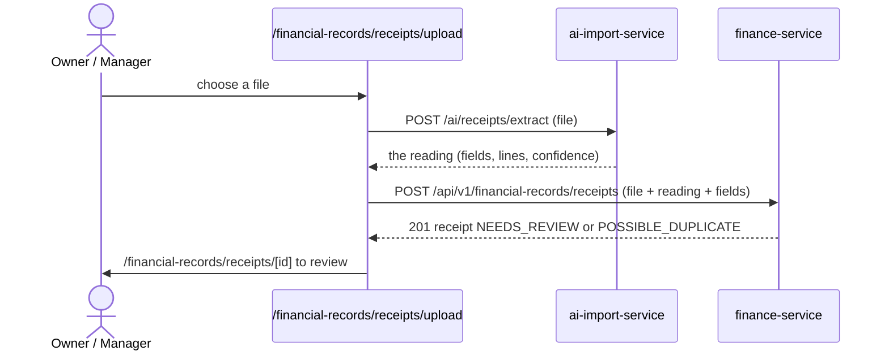
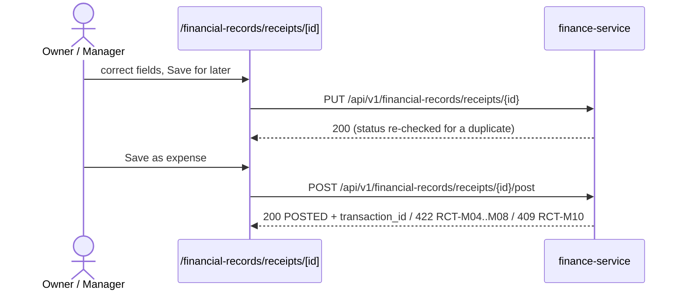

# Spec: Receipts

**Prefix:** `RCT` · **Status:** 📝 Draft · **Version:** v3.1.0 · **Author:** Vuththana
**Tables:** `receipts`, `receipt_lines`, `documents` (all new, §8) · reads `financial_accounts`, `business_categories`, `transactions`, `bank_transactions`, `change_logs`
**Endpoints:** none listed in `api/` yet · new ones listed in §9
**Routes:** `/financial-records/receipts` (Owner, Manager) · `/financial-records/receipts/upload` (Owner, Manager) · `/financial-records/receipts/new` (Owner, Manager) · `/financial-records/receipts/[id]` (Owner, Manager)

## 1. Summary and scope

A shop pays for small things every day (supplies, repairs, fuel) and keeps a paper receipt. Today the owner or branch
manager can have AI read a receipt photo in the web app, but finance-service can't save it, so the receipt is lost and
the expense has to be typed again as a transaction. This feature saves receipts in finance-service: from an AI-read
photo or PDF, or typed in by hand. The user checks the fields, the system warns about a possible duplicate, and the
receipt is posted as one expense transaction. A posted receipt is never edited or deleted; it is reversed.

- **In:** upload a receipt file with its AI reading and save it for review; type in a receipt with no file; list,
  filter and count receipts; open one with its lines, file and history; edit an unposted receipt; resolve a possible
  duplicate; post as an expense; discard an unposted receipt; reverse a posted receipt.
- **Out:**
  - The AI reading itself: `POST /ai/receipts/extract` on the AI & Import service. The web calls it, then sends the
    result here (RCT-D03).
  - Bank reconciliation of the posted expense. The existing reconciliation flow matches it like any other transaction;
    this spec only shows its state (RCT-R40).
  - CSV export of the list (RCT-Q05).
  - Mobile (Android) screens.
- **Depends on:** financial accounts, business categories and the transaction ledger as built in finance-service. They
  have no spec in this docs version, so their rules are named by table and field.

## 2. Roles and branch scope

| Role | Can | Scope |
|---|---|---|
| `BUSINESS_OWNER` | Everything in this spec | All branches, or one when switched |
| `BRANCH_MANAGER` | Everything in this spec | Locked to `users.branch_id` |

- A receipt belongs to one branch once it has an account (RCT-R12). Before that its branch is the creator's: a
  manager's own branch, or the owner's picked branch, or none for an owner on "All branches" (RCT-R04).
- An owner sees receipts of every branch and those with no branch yet. A manager sees only receipts of their branch
  (RCT-R30).
- Business-wide accounts (`financial_accounts.branch_id` null) can pay for a receipt; a branch then has to be chosen
  (RCT-R13).
- A deactivated user's receipts stay. Who created a receipt is kept in `receipts.created_by_user_id`.
- Discarded receipts are deleted (RCT-D05); nothing is soft-deleted.

## 3. Decisions

| ID | Topic | Decision |
|---|---|---|
| **RCT-D01** | Scope of the spec | A standalone `receipts` spec. The web code cites a financial-records (FRC) spec for receipts, which isn't in these docs (answered 2026-11-16 by Vuththana). |
| **RCT-D02** | Roles | Owner and Manager both use every action; the manager only in their own branch (answered 2026-11-16 by Vuththana). |
| **RCT-D03** | Where the file and reading live | finance-service owns `receipts`, `receipt_lines` and `documents`. The web calls AI extract, then sends the file and the reading to finance-service in one request. The file is stored in RustFS (S3) under a per-business key; the reading goes in `documents.extraction` (answered 2026-11-16 by Vuththana). |
| **RCT-D04** | Statuses | `NEEDS_REVIEW`, `POSSIBLE_DUPLICATE`, `POSTED`, `REVERSED` (answered 2026-11-16 by Vuththana). |
| **RCT-D05** | Discard | Discarding deletes the receipt, its lines, its `documents` row and the stored file. A `change_logs` row stays (answered 2026-11-16 by Vuththana). |
| **RCT-D06** | Possible duplicate | Same vendor (ignoring case and outer spaces), same receipt date, same total and currency (answered 2026-11-16 by Vuththana). What it is compared against: RCT-Q03. |
| **RCT-D07** | Reversal | Posts one opposite transaction, sets the receipt to `REVERSED`, and requires a reason. It is refused while the expense is matched to a bank statement line (answered 2026-11-16 by Vuththana). |
| **RCT-D08** | Typed-in receipts | Allowed with no file. They post with transaction source `MANUAL_ENTRY`; receipts with a file post with `AI_RECEIPT` (answered 2026-11-16 by Vuththana). |
| **RCT-D09** | Files | JPG, PNG, WebP or PDF, at most 10 MB, the same as the existing attachments endpoint. An unreadable file is still saved, with an empty form (answered 2026-11-16 by Vuththana). |
| **RCT-D10** | Branch and rate at posting | The branch is the account's branch; a business-wide account needs a chosen branch. `exchange_rate` and `usd_equivalent` are set by the server from `businesses.exchange_rate` when the receipt is posted (answered 2026-11-16 by Vuththana). |
| **RCT-D11** | List | Server-side paging, 20 a page, newest `receipt_date` then `created_at` first (answered 2026-11-16 by Vuththana). |
| **RCT-D12** | Receipt code | `RCP-{yyyy}-{seq}`: a per-business yearly counter, like sales-service's `INV-2026-0001` (answered 2026-11-16 by Vuththana). |
| **RCT-D13** | Posted receipts | Read-only; to fix one, reverse it and enter a new one (answered 2026-11-16 by Vuththana). |
| **RCT-D14** | Category field name | Proposal: receipts use `business_category_id`, as `transactions` do. The web type's `category_id` is renamed to match. |
| **RCT-D15** | Save for later | Proposal: an unposted receipt can be saved with missing or invalid fields; the required-field rules apply only at posting (RCT-R20). This matches the web's "Saved for later". |
| **RCT-D16** | Year of the code | Proposal: the year in `receipt_code` is the year the receipt is created, in Asia/Phnom_Penh, not the receipt date. |

## 4. Journeys

> Diagrams are Mermaid. Steps marked *server* are simulated by the web-ui mock until the endpoint exists.

### 4a. Upload a receipt

If AI can't read the file, the web still saves it with the reading marked unreadable and no fields. The user then
types the fields in. Requirements: RCT-R01 to RCT-R08.

### 4b. Type in a receipt

`/financial-records/receipts/new`. The same form with no file, saved with
`POST /api/v1/financial-records/receipts` and no file part. Requirements: RCT-R01, RCT-R03 to RCT-R08.

### 4c. Review, save for later and post

Requirements: RCT-R09 to RCT-R22.

### 4d. Possible duplicate

On the review page of a `POSSIBLE_DUPLICATE` receipt, the user compares it with the match. Then either:
- "Same expense, discard receipt" (§4f), or
- "Not a duplicate, continue review": `POST .../{id}/not-duplicate`, and the receipt goes to `NEEDS_REVIEW`.

Requirements: RCT-R23 to RCT-R26.

### 4e. List

`/financial-records/receipts` shows the cards, the status tabs, the filters, a page of rows, and a search box.
Requirements: RCT-R30 to RCT-R35.

### 4f. Discard

From an unposted receipt: a confirmation, then `DELETE .../{id}`. Requirements: RCT-R36, RCT-R37.

### 4g. Reverse

From a posted receipt: a reason, then `POST .../{id}/reverse`. Requirements: RCT-R38 to RCT-R40.

## 5. Requirements

### Upload and type in (§4a, §4b)

- **RCT-R01** · Owner, Manager · §4a — When a receipt is saved, the system creates it with a new `receipt_code` `RCP-{yyyy}-{seq}`, unique per business (RCT-D12, RCT-D16), and returns it with 201.
- **RCT-R02** · Owner, Manager · §4a — A file that isn't JPG, PNG, WebP or PDF is refused with RCT-M01, and a file over 10 MB with RCT-M02; nothing is saved.
- **RCT-R03** · Owner, Manager · §4a — When a file is sent, the system stores it in RustFS under a key private to the business and creates one `documents` row. The row holds the file's name, content type, size, the key, and the AI reading as sent in `documents.extraction`. `receipts.document_id` points to the row.
- **RCT-R04** · Owner, Manager · §4a — A new receipt's `branch_id` is the manager's branch, the owner's picked branch, or null for an owner on "All branches". A sent `financial_account_id` overrides this (RCT-R12).
- **RCT-R05** · Owner, Manager · §4a — The fields sent with a new receipt are saved as they are, even when incomplete (RCT-D15). Each sent field must still meet its dictionary length and type, or the request is refused with RCT-M03 naming the field.
- **RCT-R06** · Owner, Manager · §4a — A new receipt's status is `POSSIBLE_DUPLICATE` when RCT-R23 finds a match, otherwise `NEEDS_REVIEW`.
- **RCT-R07** · Owner, Manager · §4a — `receipts.created_by_user_id` is the caller and `created_at` is now. A `change_logs` row records the creation.
- **RCT-R08** · Owner, Manager · §4b — A receipt saved with no file has `document_id` null.

### Review and save for later (§4c)

- **RCT-R09** · Owner, Manager · §4c — While a receipt is `NEEDS_REVIEW` or `POSSIBLE_DUPLICATE`, `PUT .../{id}` replaces its fields and its lines with the ones sent, under the same rule as RCT-R05.
- **RCT-R10** · Owner, Manager · §4c — After each save, the duplicate check (RCT-R23) runs again. A receipt marked not a duplicate (RCT-R25) stays `NEEDS_REVIEW` unless the vendor, date, total or currency changed.
- **RCT-R11** · Owner, Manager · §4c — Editing a `POSTED` or `REVERSED` receipt is refused with RCT-M09 (RCT-D13).
- **RCT-R12** · Owner, Manager · §4c — When `financial_account_id` is set to an account with a branch, `receipts.branch_id` becomes that branch.
- **RCT-R13** · Owner, Manager · §4c — With a business-wide account, the receipt keeps the branch sent with it, or the manager's own branch.
- **RCT-R14** · Manager · §4c — A manager can only choose an account of their own branch or a business-wide account; any other is refused with RCT-M11.
- **RCT-R15** · Owner, Manager · §4c — Each save writes a `change_logs` row with the changed fields.

### Post as an expense (§4c)

- **RCT-R16** · Owner, Manager · §4c — Posting is allowed only from `NEEDS_REVIEW`. A `POSSIBLE_DUPLICATE` receipt is refused with RCT-M10 until it is resolved (RCT-R25); a `POSTED` or `REVERSED` one with RCT-M09.
- **RCT-R17** · Owner, Manager · §4c — Posting creates exactly one `transactions` row with:
  - `transaction_type` `EXPENSE` and status `POSTED`
  - `transaction_date` = `receipt_date`
  - the receipt's total and currency
  - its `financial_account_id`, `business_category_id` and `branch_id`
  - `counterparty_name` = `vendor_name` and `reference_number` = `receipt_number`
  - `source` `AI_RECEIPT` when the receipt has a file, else `MANUAL_ENTRY` (RCT-D08)
- **RCT-R18** · Owner, Manager · §4c — On posting, the system sets `exchange_rate` from `businesses.exchange_rate` and computes `usd_equivalent` (RCT-D10).
- **RCT-R19** · Owner, Manager · §4c — After posting, the receipt is `POSTED` and its `transaction_id` points to the new transaction. Account balances change as for any posted expense, and a `change_logs` row records it.
- **RCT-R20** · Owner, Manager · §4c — Posting is refused with RCT-M04, naming every missing or invalid field, unless all of these hold:
  - `vendor_name`, `receipt_date`, `business_category_id` and `financial_account_id` are set
  - the receipt has a `branch_id`
  - the total is more than 0
- **RCT-R21** · Owner, Manager · §4c — Posting is refused with RCT-M05 when `receipt_date` is after today in Asia/Phnom_Penh.
- **RCT-R22** · Owner, Manager · §4c — Posting is refused with RCT-M06 when the account is inactive, and with RCT-M07 when the category is inactive or isn't an `EXPENSE` category.

### Possible duplicate (§4d)

- **RCT-R23** · Owner, Manager · §4d — A receipt is a possible duplicate when another record in the same business has the same vendor (case-insensitive, trimmed), the same `receipt_date`, and the same total and currency (RCT-D06). The records compared against are set by RCT-Q03.
- **RCT-R24** · Owner, Manager · §4d — When a match is a transaction, `receipts.duplicate_of_transaction_id` holds it, and the review page links to it with "Open matching transaction".
- **RCT-R25** · Owner, Manager · §4d — "Not a duplicate" (`POST .../{id}/not-duplicate`) on a `POSSIBLE_DUPLICATE` receipt sets it to `NEEDS_REVIEW` and clears `duplicate_of_transaction_id`. It records `NOT_DUPLICATE` in `change_logs`; no reason is asked.
- **RCT-R26** · Owner, Manager · §4d — "Not a duplicate" on any other status is refused with RCT-M12.

### List (§4e)

- **RCT-R30** · Owner, Manager · §4e — `GET /receipts` returns only receipts in the caller's scope (§2), 20 a page by default, newest `receipt_date` first, then newest `created_at`; receipts with no date come last (RCT-D11).
- **RCT-R31** · Owner, Manager · §4e — The list filters by:
  - `status`
  - `business_category_id` and `financial_account_id`
  - a `receipt_date` range, inclusive
  - `branch_id` (Owner only)
  - a search that matches `vendor_name` or `receipt_number` (contains, case-insensitive), or the total when the search is a number
- **RCT-R32** · Owner, Manager · §4e — Each row has:
  - `receipt_id` and `receipt_code`
  - `vendor_name`, `receipt_date` and the category name
  - the account name, the total and currency, `usd_equivalent` and `status`
  - the branch name (shown to the owner only)
- **RCT-R33** · Owner, Manager · §4e — `GET /receipts/summary` returns, in the caller's scope:
  - the count and USD total of receipts posted in the current month (by `receipt_date`)
  - the count and USD total of `POSSIBLE_DUPLICATE` receipts
  - the count of `NEEDS_REVIEW` receipts
  - the count of posted receipts paid from a bank or wallet account whose transaction isn't matched to a statement line yet

  Unposted receipts count in USD at today's `businesses.exchange_rate`.
- **RCT-R34** · Owner, Manager · §4e — `GET /receipts/{id}` returns the receipt with its lines, its file's name, type and size, and its `change_logs` history. When posted, it also returns the transaction's reference and its matched state (RCT-R40).
- **RCT-R35** · Owner, Manager · §4e — `GET /receipts/{id}/document` returns a pre-signed link to the file, valid 15 minutes, the same as the attachments endpoint.

### Discard (§4f)

- **RCT-R36** · Owner, Manager · §4f — Discarding a `NEEDS_REVIEW` or `POSSIBLE_DUPLICATE` receipt deletes the receipt, its lines, its `documents` row and the stored file, and writes a `DISCARDED` `change_logs` row with the receipt's code, vendor and total (RCT-D05).
- **RCT-R37** · Owner, Manager · §4f — Discarding a `POSTED` or `REVERSED` receipt is refused with RCT-M09.

### Reverse (§4g)

- **RCT-R38** · Owner, Manager · §4g — Reversing a `POSTED` receipt requires a reason of 1 to 500 characters (RCT-M13). It posts one opposite transaction with `reverses_transaction_id` = the receipt's transaction, sets the receipt to `REVERSED` and saves `reversal_reason`. A `change_logs` row records it (RCT-D07).
- **RCT-R39** · Owner, Manager · §4g — Reversing is refused with RCT-M14 while a `bank_transactions` row has `matched_transaction_id` = the receipt's transaction, and with RCT-M09 when the receipt isn't `POSTED`.
- **RCT-R40** · Owner, Manager · §4c — A posted receipt paid from a `CASH_TILL` account shows "Nothing to reconcile". One paid from a `BANK_ACCOUNT` or `MOBILE_WALLET` shows waiting until a statement line is matched to its transaction, then matched.

### Fields

| Field | Rule (from the data dictionary) | Requirement |
|---|---|---|
| `receipts.vendor_name` | varchar 100; required to post | RCT-R05, RCT-R20 |
| `receipts.receipt_number` | varchar 50; optional | RCT-R05 |
| `receipts.receipt_date` | date; required to post; not after today | RCT-R20, RCT-R21 |
| `receipts.original_amount` | numeric(15,2); the total; > 0 to post | RCT-R20 |
| `receipts.original_currency` | enum USD, KHR | RCT-R05 |
| `receipts.business_category_id` | an active `EXPENSE` category; required to post | RCT-R20, RCT-R22 |
| `receipts.financial_account_id` | an active account in scope; required to post | RCT-R14, RCT-R22 |
| `receipts.reversal_reason` | varchar 500; required to reverse | RCT-R38 |
| `receipt_lines.description` | varchar 200 | RCT-R05 |
| `documents.size_bytes` | at most 10 MB (10 485 760) | RCT-R02 |

## 6. Messages

| ID | HTTP · code | Text (English; Khmer later) | Used by |
|---|---|---|---|
| **RCT-M01** | `415 · UNSUPPORTED_FILE_TYPE` | "This file type can't be read. Upload a JPG, PNG or PDF of one receipt." | RCT-R02 |
| **RCT-M02** | `413 · FILE_TOO_LARGE` | "The file is larger than 10 MB." | RCT-R02 |
| **RCT-M03** | `400 · VALIDATION_FAILED` | "{field} {problem}" (one per field, e.g. "vendor_name is at most 100 characters") | RCT-R05 |
| **RCT-M04** | `422 · RECEIPT_INCOMPLETE` | "Fix {n} fields to save this receipt" (with the list of fields) | RCT-R20 |
| **RCT-M05** | `422 · RECEIPT_DATE_IN_FUTURE` | "Receipt date can't be in the future." | RCT-R21 |
| **RCT-M06** | `422 · ACCOUNT_INACTIVE` | "{account} was turned off on {date}. Pick an active account, then save again." | RCT-R22 |
| **RCT-M07** | `422 · CATEGORY_INACTIVE` | "{category} is turned off or isn't an expense category. Pick another category." | RCT-R22 |
| **RCT-M08** | `404 · NOT_FOUND` | "Receipt not found" | RCT-E02, RCT-E03 |
| **RCT-M09** | `409 · RECEIPT_NOT_EDITABLE` | "This receipt is {status} and can't be changed." | RCT-R11, RCT-R16, RCT-R37, RCT-R39 |
| **RCT-M10** | `409 · RECEIPT_POSSIBLE_DUPLICATE` | "This receipt looks like an expense that is already saved. Compare them, then choose what to do so nothing is counted twice." | RCT-R16 |
| **RCT-M11** | `403 · BRANCH_ACCESS_DENIED` | "You can only use accounts of your branch." | RCT-R14 |
| **RCT-M12** | `409 · RECEIPT_NOT_DUPLICATE` | "This receipt isn't marked as a possible duplicate." | RCT-R26 |
| **RCT-M13** | `400 · VALIDATION_FAILED` | "Enter a reason for reversing." | RCT-R38 |
| **RCT-M14** | `409 · TRANSACTION_ALREADY_MATCHED` | "This expense is matched to a statement line. Unmatch it first." | RCT-R39 |
| **RCT-M15** | `201` | "Receipt saved" | RCT-R01 |
| **RCT-M16** | `200` | "{receipt} is posted as {transaction}." | RCT-R19 |
| **RCT-M17** | `200` | "{receipt} from {vendor} was removed. Nothing was counted." | RCT-R36 |
| **RCT-M18** | `200` | "{receipt} is now Reversed. {amount} went back to {account}." | RCT-R38 |

## 7. Edge cases

- **RCT-E01** · Actions — Two "Save as expense" clicks or two users post the same receipt at once → one transaction is created and the receipt is `POSTED`; the other request gets RCT-M09.
- **RCT-E02** · Permissions — A manager opens, edits, posts, discards or reverses a receipt of another branch by id → 404 with RCT-M08, so the receipt's existence isn't revealed.
- **RCT-E03** · Permissions — Any user asks for a receipt of another business by id → 404 with RCT-M08.
- **RCT-E04** · Permissions — A manager opens a receipt with no branch yet (created by an owner on "All branches") → not visible to the manager (RCT-R30); 404 with RCT-M08.
- **RCT-E05** · State — The account is turned off between review and posting → posting is refused with RCT-M06, and the receipt stays `NEEDS_REVIEW` with its fields.
- **RCT-E06** · State — The category is turned off between review and posting → posting is refused with RCT-M07.
- **RCT-E07** · Timing — `receipt_date` is today in Asia/Phnom_Penh but tomorrow in UTC (or the other way) → today is taken in Asia/Phnom_Penh (RCT-R21).
- **RCT-E08** · Money — A KHR receipt has a decimal total → refused with RCT-M03 ("original_amount has no decimals for KHR"), the same as other KHR amounts in finance-service.
- **RCT-E09** · Money — The exchange rate changes between saving and posting → the rate at posting is used (RCT-R18); the summary card counts an unposted receipt at today's rate (RCT-R33).
- **RCT-E10** · Data — The file was saved but AI couldn't read it → the receipt is `NEEDS_REVIEW` with empty fields and the file kept. The web shows the "We couldn't read this receipt" card.
- **RCT-E11** · Data — The file upload to RustFS fails → nothing is saved (no receipt row, no `documents` row), and 503 `DEPENDENCY_UNAVAILABLE` is returned.
- **RCT-E12** · Data — The stored file can't be deleted while discarding → the receipt is still deleted, and the orphaned file key is logged for cleanup.
- **RCT-E13** · Actions — A user reverses an already `REVERSED` receipt → RCT-M09; one reversal per transaction is already enforced by `uq_transactions_reverses`.
- **RCT-E14** · State — The duplicate match is itself discarded or reversed before this receipt is resolved → the receipt stays `POSSIBLE_DUPLICATE` until it is saved again or marked not a duplicate (RCT-R10, RCT-R25).
- **RCT-E15** · Actions — Two users edit the same unposted receipt → the last save wins (RCT-Q08).
- **RCT-E16** · Empty — No receipts in scope → the list is empty, and the summary counts and totals are 0.
- **RCT-E17** · Permissions — A manager's branch is deactivated → their writes are refused, as for other branch records (`BRANCH_INACTIVE`); reads still work.
- **RCT-E18** · Limits — More than 20 lines on a receipt → the number of lines is limited by RCT-Q06.

## 8. Data dictionary changes

The data dictionary in this docs version has no finance tables yet. Every field below is new.

| Table.field | Change | Why | State |
|---|---|---|---|
| `receipts` | add table: `receipt_id` uuid PK, `receipt_code` varchar 20 (unique per business), `business_id` uuid, `branch_id` uuid (nullable until an account is chosen), `receipt_number` varchar 50, `vendor_name` varchar 100, `receipt_date` date, `business_category_id` uuid FK, `financial_account_id` uuid FK, `subtotal` numeric(15,2), `tax_rate` numeric(5,2), `tax_amount` numeric(15,2), `original_amount` numeric(15,2), `original_currency` enum USD/KHR, `exchange_rate` numeric(15,4) (set at posting), `usd_equivalent` numeric(15,2) (set at posting), `status` enum NEEDS_REVIEW/POSSIBLE_DUPLICATE/POSTED/REVERSED, `duplicate_of_transaction_id` uuid FK, `transaction_id` uuid FK, `reversal_reason` varchar 500, `document_id` uuid FK, `created_by_user_id` uuid, `created_at` timestamp, `updated_at` timestamp | RCT-R01, RCT-R17, RCT-R23 | proposed |
| `receipt_lines` | add table: `receipt_line_id` uuid PK, `receipt_id` uuid FK (cascade delete), `description` varchar 200, `quantity` numeric(15,3), `unit_price` numeric(15,2), `amount` numeric(15,2), `line_order` integer | RCT-R09 | proposed |
| `documents` | add table: `document_id` uuid PK, `business_id` uuid, `file_name` varchar 255, `content_type` varchar 100, `size_bytes` bigint, `storage_key` varchar 500, `extraction` jsonb, `created_at` timestamp | RCT-R03 | proposed |
| `documents.extraction` | add a jsonb shape: the AI reading as sent by the web (RCT-Q01) | RCT-R03 | proposed |
| `change_logs.record_type` | add value `RECEIPT` | RCT-R07 | proposed |

## 9. Endpoints

All are finance-service (TRD §1a: finance owns the ledger), under `/api/v1/financial-records/receipts`.

| Method · path | Service | Who | Requirements | In api/? |
|---|---|---|---|---|
| `POST /api/v1/financial-records/receipts` (multipart: `file` optional, `receipt` JSON with fields, lines and `extraction`) | finance-service | Owner, Manager | RCT-R01 to RCT-R08 | 📝 planned |
| `GET /api/v1/financial-records/receipts` | finance-service | Owner, Manager | RCT-R30 to RCT-R32 | 📝 planned |
| `GET /api/v1/financial-records/receipts/summary` | finance-service | Owner, Manager | RCT-R33 | 📝 planned |
| `GET /api/v1/financial-records/receipts/{id}` | finance-service | Owner, Manager | RCT-R34, RCT-R40 | 📝 planned |
| `GET /api/v1/financial-records/receipts/{id}/document` | finance-service | Owner, Manager | RCT-R35 | 📝 planned |
| `PUT /api/v1/financial-records/receipts/{id}` | finance-service | Owner, Manager | RCT-R09 to RCT-R15 | 📝 planned |
| `POST /api/v1/financial-records/receipts/{id}/post` | finance-service | Owner, Manager | RCT-R16 to RCT-R22 | 📝 planned |
| `POST /api/v1/financial-records/receipts/{id}/not-duplicate` | finance-service | Owner, Manager | RCT-R25, RCT-R26 | 📝 planned |
| `DELETE /api/v1/financial-records/receipts/{id}` | finance-service | Owner, Manager | RCT-R36, RCT-R37 | 📝 planned |
| `POST /api/v1/financial-records/receipts/{id}/reverse` | finance-service | Owner, Manager | RCT-R38, RCT-R39 | 📝 planned |

## 10. Questions

- **RCT-Q01** · §8 — Which shape does `documents.extraction` store? *Options:*
  - (a) the current `POST /ai/receipts/extract` response as is (per field `{value, confidence, source_text}`, `line_items`, `issues`, `overall_confidence`) — no mapping needed, but the web's older `documents.extraction` type has a different shape;
  - (b) the older web shape (`read_status` READ/UNREADABLE, per field `{value, confidence 0–100, flag}`) — the web's review highlights already use it, but the AI response must be mapped.

  *Suggested:* (a), stored as received; needs the AI team to confirm the confidence scale.
- **RCT-Q02** · §4a — Does finance-service check the reading, or store it as given? *Options:*
  - (a) store it as given, capped at 256 KB — simple; the reading is only shown to the user;
  - (b) validate it against the RCT-Q01 shape — catches bad data, but is tied to the AI response version.
- **RCT-Q03** · §4d — What is a receipt compared against for a possible duplicate? *Options:*
  - (a) other unposted and posted receipts, plus posted `EXPENSE` transactions in the business, matched on `counterparty_name` — catches a receipt for a bill already paid, but transactions' `counterparty_name` is often empty;
  - (b) receipts only — simpler, but misses expenses typed in as transactions;
  - (c) as (a), limited to the receipt's branch — fewer false matches across branches.

  When the match is an unposted receipt, `duplicate_of_transaction_id` is empty: should `duplicate_of_receipt_id` be added?
- **RCT-Q04** · §2 — Can a manager discard or reverse a receipt an owner created in their branch? *Suggested:* yes; scope is by branch, not by creator (RCT-D02).
- **RCT-Q05** · §1 — Is CSV export of the receipt list in this spec? The web has an Export button and columns. *Options:*
  - (a) in: `GET /receipts/export` with the list filters;
  - (b) later, in its own change.
- **RCT-Q06** · §5 — Line rules. Are lines required to post? Must the lines add up to `subtotal`, and `subtotal + tax_amount` to `original_amount`? What is the most lines a receipt can have? *Options:*
  - (a) lines are optional, totals are not cross-checked, at most 100 lines — AI readings are often off by rounding;
  - (b) at least one line, and the totals must add up to within 0.01;
  - (c) as (b), but a mismatch only warns.
- **RCT-Q07** · §5 — Tax. Is `tax_amount` entered, or computed from `tax_rate` × `subtotal`? Is `tax_rate` limited, for example 0 to 100?
- **RCT-Q08** · §7 — Should two people editing the same receipt be protected? *Options:*
  - (a) last save wins — simplest;
  - (b) `updated_at` sent back, and a stale save gets 409 — safer, more work in the web.
